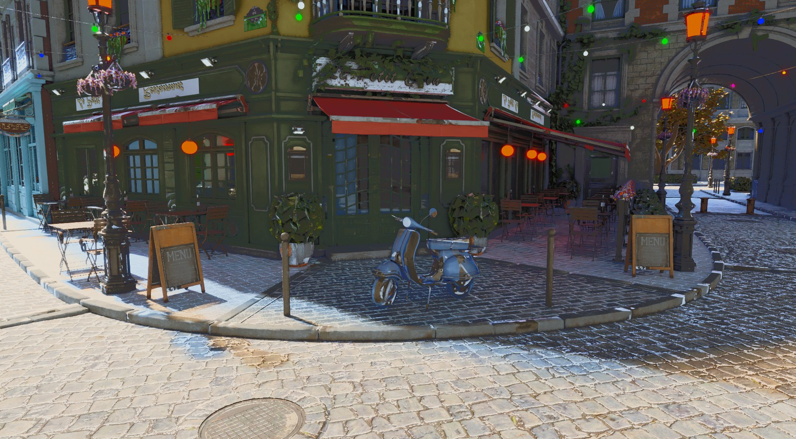
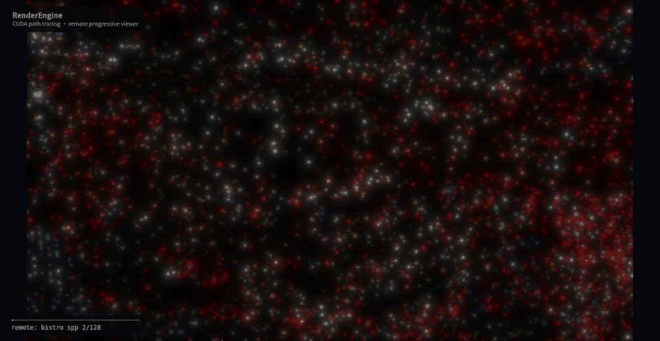
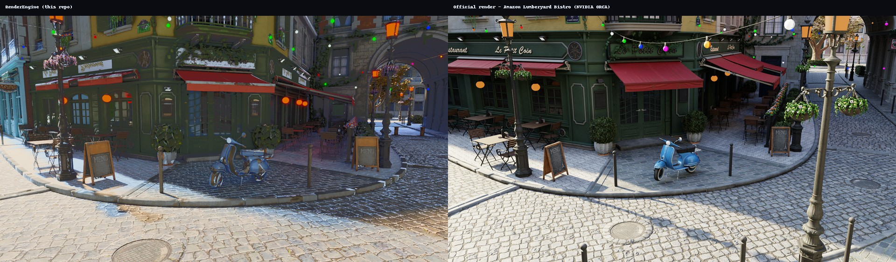
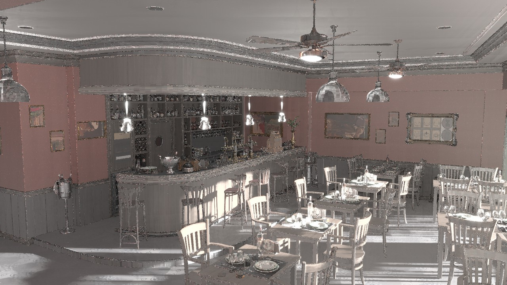
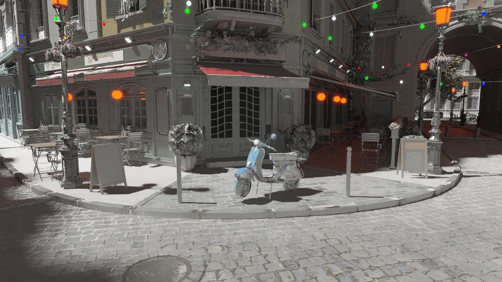
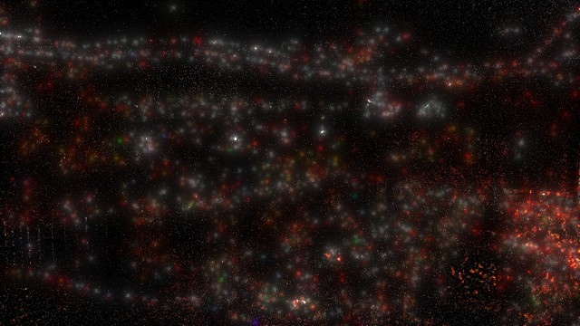
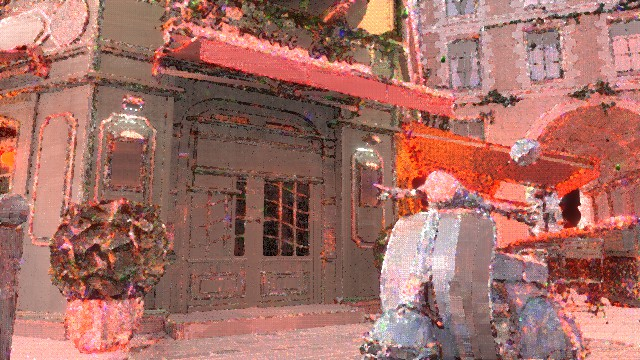

# Raypr3sso — CUDA 路径追踪渲染器 + 浏览器实时查看

**一句话**：从零实现的 CUDA 路径追踪渲染器（Disney BSDF / MIS / BVH / 波前管线 / 自研降噪与调色），
对标 NVIDIA 官方 Bistro 渲染图逐区域校准，并通过内置的远程渲染服务在浏览器里
**实时渐进查看**——首帧 ~0.8s，拖动环视、滚轮进出建筑，停手后 960×540@128spp 自动精修。

<p>


</p>

## 30 秒上手

```bash
./demo.sh        # 预检显存 →（按需）构建 → 起服务端+页面 → 打开浏览器
```

需要 NVIDIA GPU（CUDA 12.x）。模型资产（Amazon Lumberyard Bistro，~1.8GB）放在
`models/` 下，获取方式见[下方说明](#第二步设置渲染参数)。

## 特性 × 实测数字

| 特性 | 数字 |
|------|------|
| 浏览器实时查看（拖动档 320×180@8spp） | 首帧 ~0.8s，JPEG 预览 ~130KB |
| 渐进精修（960×540 @128spp，自适应采样 + OIDN 终帧） | ~8s 完整收敛，spp 进度条实时可见 |
| 官方白天外景对齐（逐区域校准，README §13.13） | mean 0.98× / 街面 0.98× / R/B 1.053 vs 1.019 |
| 内景对齐（红墙/地板/中位亮度） | 红墙 0.395 vs 官方 0.394，地板 -6% |
| 合并内外景浏览（双 FBX 同一 BVH，窗内外互通） | 3.9M 面 / 618 纹理，加载 ~1 分钟 |
| 纹理 BC 压缩驻显存（内核软件解码） | 纹理显存 -80%（1.6GB），逐字节无损 |
| 降噪 | 自研 NL-means（行并行）+ Intel OIDN 双路，能量守恒增益 |

<p>

</p>

## 画廊

| | |
|---|---|
|  |  |
| 内景交付（灯具校准 + 穿窗太阳） | 白天外景交付（黄昏 HDR 染蓝标定） |
|  |  |
| 合并场景 · 室内视角（实时预览） | 合并场景 · 街面视角（实时预览） |

交互 GIF（渐进收敛）：`gallery/refine.gif`（上图右）。

## 深入阅读

- **本 README 其余部分**：完整实现报告——管线设计、材质系统、降噪器、与官方渲染的
  量化对齐过程、四轮全代码审计、GPU 性能实测、远程渲染架构（六阶段）与踩坑记录。
- [`ARCH.md`](ARCH.md) 架构文档 · [`REMOTE_RENDERING_DESIGN.md`](REMOTE_RENDERING_DESIGN.md) 远程渲染设计
- 验证脚本：`scripts/bench_refine.py`（延迟基准）、`scripts/e2e_bistro_combined.py`（无头浏览器
  端到端）、`scripts/run_server_chunk_ab.sh`（字节级一致性）、`scripts/test_midmove_ab.py`（并发竞争）
- `deploy/`：systemd / nginx / Dockerfile 部署件

## 致谢

- 场景资产：[Amazon Lumberyard Bistro](https://developer.nvidia.com/orca/amazon-lumberyard-bistro)（NVIDIA ORCA，见对比图右侧官方渲染版权属 NVIDIA）
- 降噪：[Intel Open Image Denoise](https://www.openimagedenoise.org/)
- three.js / OrbitControls、stb、glm、CUB

---

**Raypr3sso** 是一款基于 CUDA 的离线路径追踪渲染器，支持 CPU + GPU (CUDA) 双后端，实现 Disney BSDF、BVH 加速、多重重要性采样（MIS）等核心渲染技术。目标场景为 [Amazon Lumberyard Bistro](https://developer.nvidia.com/orca/amazon-lumberyard-bistro) 开源场景。

## 目录结构

```
Raypr3sso/
├── CMakeLists.txt           # 构建文件（目标：Raypr3sso CLI + render_server）
├── demo.sh                  # 一键：预检显存 → 构建 → 起服务端+页面 → 开浏览器
├── external/                # 第三方库 (glm, stb；可选 OIDN 预编译包)
├── include/                 # 公共头文件 (types.h, math_utils.h)
├── src/                     # 源码
│   ├── console.cpp          # 交互式控制台（CLI 渲染入口）
│   ├── model.cpp / material.cpp      # FBX 加载 (assimp) + DDS/BC 纹理解码
│   ├── bvh.cpp / bvh_gpu.cu          # SAH BVH 构建 + GPU Linear BVH
│   ├── sampling.cpp                  # Disney BSDF + 重要性采样
│   ├── render.cpp                    # CPU 后端（参考验证用）
│   ├── render_gpu.cu                 # GPU megakernel 路径追踪
│   ├── render_wavefront.cu           # GPU 波前管线（重排序/材质分批）
│   ├── image.cpp                     # 降噪 (NL-means/OIDN) + 后处理
│   ├── gpu_scene.cpp / gpu_utils.cpp # GPU 场景常驻资源 / 上传
│   └── render_server.cpp / render_job.cpp  # 远程渲染服务（HTTP+WS）
├── threejs/                 # 浏览器前端（three.js 远程客户端）
├── scripts/                 # 验证/标定/交付脚本（attic/ 为历史归档）
├── deploy/                  # systemd / nginx / Dockerfile 部署件
├── gallery/                 # 交付渲染图与对比图
├── models/                  # Bistro 模型文件（需自行下载）
│   └── Bistro_v5_2/         # ~1.3M 面 (内景) / ~2.8M 面 (外景)
├── output/                  # 渲染输出
├── reference/               # CPU 参考实现 Raym0nade（本地副本，可选，不随仓库分发）
└── build/                   # 构建输出
```

## 环境依赖

| 依赖 | 版本要求 | Ubuntu 安装命令 |
|------|---------|----------------|
| CMake | ≥ 3.18 | `apt install cmake` |
| C++17 编译器 | GCC ≥ 9 | `apt install g++` |
| CUDA Toolkit | ≥ 12.x | 见 CUDA 安装文档 |
| assimp | ≥ 5.x | `apt install libassimp-dev` |
| glm | header-only | FetchContent 自动拉取 |
| stb | header-only | FetchContent 自动拉取 |
| OIDN（可选） | 2.2.0 预编译 | 手动安装见[「可选：OIDN 降噪器」](#可选oidn-降噪器)；不装自动回退自研 NL-means |

## 编译方式

```bash
# 克隆项目后
cd Raypr3sso
mkdir -p build && cd build

# 配置（默认 CUDA 架构 sm_70，适用于 Tesla V100）
cmake .. -DCMAKE_BUILD_TYPE=Release

# 可指定 CUDA 架构（如 RTX 3090 用 sm_86）
cmake .. -DCMAKE_BUILD_TYPE=Release -DCUDA_ARCH=86

# 编译
make -j$(nproc)

# 产物位于 build/Raypr3sso（CLI）与 build/render_server（远程渲染服务）
```

### CMake 选项

| 选项 | 默认值 | 说明 |
|------|--------|------|
| `-DCUDA_ARCH=70` | 70 | CUDA 计算能力 (70=V100, 86=RTX 3090, 90=H100) |
| `-DRENDERER_USE_TINYEXR=OFF` | OFF | 开启 EXR 输出支持 |
| `-DCMAKE_BUILD_TYPE=Release` | — | Release 模式开启 O2 优化 |

### 可选：OIDN 降噪器

自研 NL-means 开箱即用；安装 Intel [OIDN](https://www.openimagedenoise.org/)（机器学习
降噪，albedo+normal 引导）后可用 `RENDER_OIDN=1` 获得更好的精修终帧质量（自适应采样
也只在 OIDN 可用时启用）。OIDN 为**可选**依赖，不安装不影响编译与其余功能。

```bash
# 从官方 releases 页下载 Linux x64 预编译包：
# https://github.com/AcademySoftwareFoundation/OpenImageDenoise/releases/tag/v2.2.0
# （资产名 oidn-2.2.0.x86_64.linux.tar.gz，约 80MB）
mkdir -p external/oidn
tar xzf oidn-2.2.0.x86_64.linux.tar.gz -C external/oidn

# 重新 cmake 配置；探测成功会打印：
#   -- Found OIDN at .../external/oidn/oidn-2.2.0.x86_64.linux — RENDER_OIDN enabled
```

CMake 配置时自动探测 `external/oidn/oidn-*.x86_64.linux/`（解压出的目录名必须符合该
模式）并链接 + 设置 RPATH；目录缺失或不匹配时静默跳过，`RENDER_OIDN=1` 自动回退
自研 NL-means。该目录已被 `.gitignore` 排除，不随仓库分发。

## 使用方法

渲染器采用交互式控制台，支持管道输入。分为三个步骤：

### 第一步：加载模型

```bash
# 交互模式
./build/Raypr3sso
> create model bistro

# 或在启动时通过命令行指定参数（单行格式）
./build/Raypr3sso <<< 'create model bistro models/Bistro_v5_2 BistroInterior_Wine.fbx null'
```

模型参数说明：

| 参数 | 说明 | 示例 |
|------|------|------|
| `models/Bistro_v5_2` | 模型文件夹路径 | 相对路径或绝对路径 |
| `BistroInterior_Wine.fbx` | FBX 模型文件名 | 见下方可用模型表 |
| `null` | 天空盒文件，`null`=不使用 | 外景可用 `san_giuseppe_bridge_4k.hdr` |

可用模型：

| 模型文件 | 面数 | 说明 |
|---------|------|------|
| `BistroInterior_Wine.fbx` | ~1.32M | 内景（含酒瓶、吧台） |
| `BistroInterior.fbx` | ~1.3M | 内景（无酒瓶） |
| `BistroExterior.fbx` | ~2.8M | 外景（街景） |

### 第二步：设置渲染参数

```bash
# 使用预设（推荐）
> preset interior myargs

# 或手动创建
> create args custom
```

预设参数：

| 预设名 | 分辨率 | spp | 说明 |
|--------|--------|-----|------|
| `interior` | 1920×1080 | 4096 | Bistro 内景交付效果（含标定 rig：穿窗太阳 + 灯具增益） |
| `interior_quick` | 1920×1080 | 320 | 内景交付效果的低 SPP 验证档 |
| `daylight` | 1920×1061 | 2048（自适应预算） | **官方白天外景对齐**（v11 交付 rig，一键复现官方效果） |
| `exterior` | 1920×1080 | 320 | 黄昏外景交付（暖阳 + 串灯点亮） |
| `counter` | 640×480 | 256 | 吧台特写（试验性） |
| `wide` | 640×480 | 128 | 俯视全景（试验性） |
| `front` | 640×480 | 128 | 外景正面（试验性） |

**标定 rig 随预设自动生效**（2026-10-01 起）：`interior` / `daylight` / `exterior`
预设会把各自交付渲染所用的全部 `RENDER_*` 环境变量值（太阳方向/强度、天空缩放/染色/锥聚焦、
ACES、WB、饱和度、split-tone、LUT 曲线/分带、OIDN、自适应采样等）安装为本进程默认值，
`preset` + `render` 两条命令即可复现交付效果，无需外部 env。优先级：
**启动前显式设置的 env > 预设 rig > 内置默认**（`setenv` 命令同样可覆盖）。
注意 sky/emission 类旋钮在模型加载时烘焙——先 `preset` 再 `create model`（顺序反了 preset 会提示重载）。

### 官方白天效果一键复现

```bash
./scripts/render_bistro_official_match.sh          # 1080p 自适应 2048 预算，~30-70 分钟
# 或交互式：
./build/Raypr3sso << 'EOF'
preset daylight myargs
create model bext models/Bistro_v5_2 BistroExterior.fbx models/Bistro_v5_2/qwantani_azm55_4k.hdr
render bext myargs gpu
exit
EOF
```
等效交付基准：`output_gpu/final_daylight_v11/bistro_daylight_final_v11.png`
（mean 0.98× 官方、facade 1.54×、R/B 1.053 vs 1.019，README §13.13）。

### 浏览器实时浏览（内外景合一）

`bistro` 场景把 `BistroInterior.fbx` + `BistroExterior.fbx` 合并进同一 BVH
（`Model::createCombined`，"窗户内外互通"）：从内景吧台机位**滚轮缩小**（dolly out）
可穿过前窗走到街面，反向从街面**放大**可进入室内。白天外亮内暗时从街面看橱窗
以玻璃反光为主，属物理正确行为。

```bash
# 1) 渲染服务端（无需任何 env——bistro preset 自带标定 rig；从仓库根启动）。
#    建议 RENDER_OIDN=1：精修终帧用 OIDN 降噪（质量更好），且自适应采样
#    只在 OIDN 可用时启用（自适应+NL-means 统计塌陷的已知组合陷阱）。
RENDER_TOKEN=devtoken RENDER_OIDN=1 ./build/render_server 127.0.0.1 9151 &
# 2) 静态页
python3 -m http.server 8080 &
# 3) 打开浏览器
xdg-open "http://127.0.0.1:8080/threejs/index.html?remote=http://127.0.0.1:9151&model=bistro&token=devtoken"
```

交互：拖动=环视（拖动档 320×180@8spp 即时预览），停止=精修档 960×540@128spp+降噪；
滚轮=沿视线进出（内↔外）。**室内自动提亮**：相机进入内景 FBX 包围盒（1.5m smoothstep
过渡带）时显示曝光从 2.5 平滑升到 6.0（display-only，不重置累积），出门自动回落——
`bistro` preset 携带该档参数，服务端经 session JSON 下发，客户端按相机位置逐帧混合。
**右上控制栈**：保存当前帧（无损 PNG）/ 回到标定机位（R）/ 实时统计面板（分辨率·有效
spp·chunk 间隔·曝光·**收敛 ETA**）/ **首帧-当前帧 A/B 对比**（可拖分割线，看降噪+收敛
前后差异）/ 全屏（F）/ 质量·曝光面板（精修分辨率四档即时切换 + 曝光滑条自动/手动）；
键盘 1-4 切画质、H 隐藏 UI；断线显示错误卡片（引用 `./demo.sh`）。场景加载（~60s）
有**真实分段进度**：引擎经 sceneProgress 钩子上报 parse/decode/geometry/materials/
upload/sky 阶段，服务端限流广播 `scene-progress` 事件，前端按阶段权重映射进度条。
所有设置同步进 URL（model/idleRes/exposure），画面可直接分享。相机参数可经 URL 覆盖：
`&targetDist=12`（轨道目标距离，默认 4m 房间尺度）。场景注册表（`render_server.cpp`
kModels）：`sphere-test` / `bistro-interior`（纯内景）/ `bistro`（内外合一 + kloppenheim
白天 HDRI），设置面板内可切换。端到端验证脚本：`scripts/test_midmove_ab.py`（渲染中
拖相机 A/B）、`scripts/e2e_bistro_combined.py`（内→外切换 + 自动提亮断言）、
`scripts/e2e_p0_ui.py` / `scripts/e2e_p1_ui.py` / `scripts/e2e_p2_ui.py`
（控制项交互验收；依赖同目录 `e2e_cdp_helper.py`）。

### 第三步：渲染

```bash
# CPU 后端
> render bistro myargs cpu

# GPU 后端（推荐）
> render bistro myargs gpu
```

### 完整渲染命令（管道模式）

```bash
./build/Raypr3sso << 'EOF'
create model bistro models/Bistro_v5_2 BistroInterior_Wine.fbx null
preset interior myargs
render bistro myargs gpu
exit
EOF
```

### 可用命令

```
create model <id> [folder model_name sky]  加载模型
create args <id>                            创建渲染参数
preset <name> <args_id>                     使用预设
render <model_id> <args_id> [cpu|gpu]       渲染场景
list models|args                            列出已创建对象
view model|args <id>                        查看详情
findgeom <model_id>                         探测场景几何体
help                                        帮助
exit                                        退出
```

## Bistro 内景场景详解

### 场景空间范围

正确加载 `BistroInterior_Wine.fbx`（使用 `aiProcess_PreTransformVertices` 后）：

```
场景包围盒:
  min = (-2.948,   0.298, -20.348)
  max = (19.880,  10.941,   8.014)
  center = (8.466, 5.620,  -6.167)
  尺寸: 22.8m × 10.6m × 28.4m
```

坐标轴含义：X 为场景纵深方向（入口→内景），Y 为垂直方向（地面→天花板），Z 为横向（左→右）。

### 相机坐标系

相机采用右手坐标系，由三个向量定义：

```
right = cross(direction, up)    # 自动计算（水平向右）
up    = 用户指定                 # 垂直向上
direction = 用户指定             # 视线方向
```

> **注意**：`up` 必须与 `direction` 近似垂直，否则 `cross(direction, up)` 可能为零向量。

视线方向计算（`camera.h` 中的 `generateRay`）：

1. 将像素坐标映射到 NDC：`ndcX = (2*px/W - 1) * aspect * tan(fov/2)`，`ndcY = (1 - 2*py/H) * tan(fov/2)`
2. 构建正交基：`w = normalize(direction)`，`u = normalize(cross(w, up))`，`v = cross(u, w)`
3. 最终方向：`dir = normalize(ndcX * u + ndcY * v + w)`

### `interior` 预设参数详解

```
相机位置   position  = (-0.833,  3.099, -1.471)
视线方向   direction = ( 0.994, -0.105, -0.036)
上向量     up        = ( 0.105,  0.994, -0.004)
垂直 FOV   fov       = 40.5°
```

#### 参数推导来源

以上参数精确对应 [Raym0nade](https://github.com/lemonchu/Raym0nade) 参考项目 `renderArguments.txt` 中的内景参数：

```
参考项目原始参数:
  direction = (0.993846, -0.104828, -0.0358017)
  right     = (0.036,     0,         0.99935179)
  up        = (-0.104761, -0.99449,   0.00377383)
  D = -1.1,  R = -1.5,   U = -3
  accuracy  = 0.00032, height = 2304
```

##### 位置计算

```
position = D * direction + R * right + U * up
         = -1.1 * (0.994, -0.105, -0.036)
           + (-1.5) * (0.036, 0, 0.999)
           + (-3) * (-0.105, -0.994, 0.004)
         = (-0.833, 3.099, -1.471)
```

##### FOV 计算

```
tan(vfov/2) = accuracy * (height / 2)
            = 0.00032 * 1152
            = 0.36864
vfov = 2 * atan(0.36864) * 180/π ≈ 40.5°
```

##### Up 向量取反原因

参考项目使用 Y-down 屏幕空间，`up` 向量指向画面下方；Raypr3sso 使用 Y-up 屏幕空间，`up` 向量应指向上方。因此对参考项目的 `up` 取反，同时在水平方向上也自动纠正 `right = cross(direction, up)` 的符号：

```
Raypr3sso up = -reference_up
               = (0.104761, 0.99449, -0.00377383)
```

#### 场景坐标与可见内容

从 `position = (-0.833, 3.099, -1.471)` 出发，以 `direction = (0.994, -0.105, -0.036)` 方向观察：

| 方向 | 场景范围 | 可见内容 |
|------|---------|---------|
| +X | -2.95 → 19.88 | 酒吧纵深方向，吧台、酒瓶架位于 x≈4-12 |
| +Y | 0.30 → 10.94 | 垂直方向，视线略向下倾斜 |
| ±Z | -20.35 → 8.01 | 横向，相机位于 z≈-1.5，视野约 72° 水平覆盖 |

相机位于场景入口附近（x≈-0.8），视线指向酒吧内部（+X方向），可看到吧台、高脚凳、酒瓶架、壁灯、吊扇、餐桌椅等核心内景陈设。

### 其他预设

| 预设 | 位置 | 方向 | FOV | 说明 |
|------|------|------|-----|------|
| `counter` | (0, 1, -2) | (0.5, 0, 0.9) | 50° | 吧台特写（待调校） |
| `wide` | (0, 30, -30) | (0.5, -0.3, 0.8) | 90° | 全景俯视（待调校） |
| `front` | (-30, 1.5, -20) | (0.6, 0, 0.8) | 60° | 外景正面（待调校） |

> `counter` / `wide` / `front` 目前为试验性参数，尚未从参考项目精确推导。

## 渲染输出

渲染完成后输出到 `output/render.png`，包含以下后处理：

| 阶段 | 说明 |
|------|------|
| 降噪 (Denoise) | 边缘感知滤波，4 轮多尺度迭代 |
| Bloom | 亮部提取 + 高斯模糊叠加 |
| Tonemap | Reinhard 色调映射 + 伽马校正 |

后处理流水线：降噪 → Bloom → FXAA → 景深 → Tonemap → Gamma。

## 参考实现

`reference/` 目录为 [Raym0nade](https://github.com/lemonchu/Raym0nade)（MIT，© Meng Chu & Yuchen Yang）的本地副本，纯 CPU 参考路径追踪器。**该副本不随本仓库分发**（`.gitignore` 已排除）；如需复现对比，自行克隆原项目放到 `reference/` 即可，脚本引用的路径（如 `reference/official_bistro_daylight.png`）随之就位。

关键差异：

| 特性 | Raypr3sso | Raym0nade (参考) |
|------|-------------|------------------|
| 后端 | CPU + GPU (CUDA) | CPU 多线程 |
| BVH | Linear BVH (GPU) | 递归 BVH (CPU) |
| 纹理加载 | stb_image (CPU) → float4 array (GPU) | Python+imageio (DDS) |
| 色调映射 | Reinhard | 线性曝光 |
| 输出格式 | PNG (stb_image_write) | PNG (libpng) |

## 常见问题

### 渲染太慢

- 默认 `interior` 预设为 4096 spp × 1920×1080，GPU 渲染约 35 分钟（V100）
- 调试时可改为低 spp + 小分辨率：修改 `console.cpp` 中 `preset interior` 的 `spp`、`width`、`height`
- CPU 后端比 GPU 慢 10-50 倍

### 场景加载失败

确认 assimp 已安装：

```bash
dpkg -l | grep libassimp
apt install libassimp-dev   # 如未安装
```

### 图像过曝或过暗

曝光值在 `console.cpp` 的 `photo.exposure` 处设置。Bistro 内景建议 3.0（搭配 Reinhard 映射）：

```cpp
// 值越大越亮。场景含自发光材质 (emFac=500-1000)
photo.exposure = 3.0f;
```

### GPU 显存不足

Bistro 内景 ~1.32M 面，纹理 ~200 张，GPU 显存占用约 15GB（V100 32GB）。如显存不足，可尝试：
- 降低分辨率
- 减少 spp
- 使用 CPU 后端

---

# 技术报告：渲染管线实现详解

本报告记录 Raypr3sso 渲染管线的完整实现方法、设计思路与实现细节，包括在将 Bistro 内景渲染对齐 NVIDIA 官方效果图过程中做的全部工程决策、踩坑记录与量化验证结果。所有数字均为实测值。

---

## 1. 渲染管线总览

```
                        ┌─────────────────────────────────────────────┐
                        │              控制台 (console.cpp)            │
                        │  create model / create args / render        │
                        └───────┬─────────────────────────────────────┘
                                │
      ┌─────────────────────────┼──────────────────────────────────┐
      ▼                         ▼                                  ▼
┌───────────────┐   ┌──────────────────────┐   ┌──────────────────────────┐
│ 资产加载       │   │ GPU 上传 (gpu_utils) │   │ 渲染参数 (GPURenderArgs) │
│ model.cpp     │   │ 顶点/法线/UV/matIds  │   │ 相机/spp/天空CDF/太阳    │
│ FBX+assimp    │   │ LinearBVH / 材质SoA  │   │                          │
│ DDS 纹理解码  │   │ uchar4 纹理池        │   │                          │
│ 发光三角收集  │   │ 灯光三角形/两级分布  │   │                          │
└───────┬───────┘   └──────────┬───────────┘   └────────────┬─────────────┘
        └──────────────────────┼─────────────────────────────┘
                               ▼
                    ┌─────────────────────────┐
                    │  renderKernel (CUDA)    │
                    │  per-pixel 路径追踪:    │
                    │  相机射线 → BVH 命中 →  │
                    │  BSDF 采样 + NEE + MIS  │
                    │  (面积灯/天空/方向阳光) │
                    │  → 4 通道 AOV 分解      │
                    └───────────┬─────────────┘
                                │ float4 AOV (Dd/Ds/Id/Is + Em + G-buffer)
                                ▼
                    ┌─────────────────────────┐
                    │  后处理 (image.cpp)     │
                    │  降噪器(7遍多尺度)      │
                    │  → AOV 重组 → Reinhard  │
                    │  → bloom → gamma → PNG  │
                    └─────────────────────────┘
```

渲染以**每像素采样累积**为核心：每个像素独立 `spp` 条路径，各路径的全部贡献按 AOV 分解到 `radiance_Dd/Ds/Id/Is`（直接漫反射/直接镜面/间接漫反射/间接镜面）与 `emission` 五个通道，另外累计 `baseColor/normal/position/shapeNormal/roughness/metallic/specular/opacity` 作为 G-buffer 供降噪器使用。方差用 Welford 式 `E[X²]−E[X]²` 在线估计，逐像素输出供降噪器自适应。

---

## 2. 资产与纹理管线

### 2.1 场景加载（model.cpp）

Bistro 内景（`BistroInterior.fbx`）经 assimp 加载，后处理 flag：`aiProcess_Triangulate | PreTransformVertices | OptimizeMeshes | FixInfacingNormals`。加载后 **1,046,609 个三角形、313 万顶点、71 种材质**，场景包围盒在加载时打印（供相机布置参考）。

材质提取按 assimp 键值：`COLOR_DIFFUSE → baseColorFactor`、`COLOR_EMISSIVE → emissionFactor`、`METALLIC/ROUGHNESS_FACTOR`、`REFRACTI → ior`、`OPACITY → opacity`。纹理映射表覆盖 `DIFFUSE/BASE_COLOR/NORMALS/METALNESS/DIFFUSE_ROUGHNESS/EMISSIVE/OPACITY`，并有 **SPECULAR → roughnessMap 的关键映射**（见 §6.2）。纹理路径解析带 URL 解码、`\`→`/`、`.dds` 后缀替换与 `Textures/` 子目录回退。

### 2.2 DDS 纹理解码（material.cpp）

自实现 DXT1/DXT3/DXT5/BC4/BC5 解码（Bistro 贴图为 DXT1 彩色图 + DXT5 规格/法线图），不支持 DX10 扩展。每个 4×4 块解压为 RGBA8；主 mip 解压后生成 mip 链（2×2 盒式滤波）供 CPU 采样。

两个关键点：

1. **`bakeAverageTexel()`（发光贴图平均色烘焙）**：加载后即按 64×64 **二维网格**采样并烘焙 `emissionTexAvg`。两个历史 bug 的教训都源于此函数——
   - 早期版本用 1D 步长 `n/4096` 采样：在 2048 宽贴图上步长恰好等于半宽，采样点只能落在 x=0 与 x=1024 **两列**上（步长混叠），平均结果对亮区不在该两列的贴图恒为 0 → 两盏灯的 NEE 贡献被静默清零；
   - 平均域错误：对原始 sRGB 字节求平均而非线性域（pow 2.2）平均，使 NEE 光强虚高约 2.1×。
   正确实现 = 2D 网格 + **线性域平均**（见 §7.2 的通量补偿）。
2. **`emissionTexAvg` 的加载时烘焙**：渲染路径直接读取烘焙值而不重新扫描贴图字节（大块 host 内存在渲染路径中被观察到被清零），烘焙时机放在 `Model` 加载结束处统一拷贝到材质。

### 2.3 纹理上传（gpu_utils.cpp / bvh_gpu.cu）

所有贴图解码为 **uchar4（RGBA8）扁平大缓冲**上传（每纹素 4 字节）：

- 历史：旧实现同时维护 `cudaArray + cudaTextureObject` 与一份 `float4` 原始数据——Bistro 的 213 张 2048² 贴图需要 **~28GB 显存**（两份完整拷贝）。当显存被其他进程挤压时 `cudaMallocArray` 失败**被静默跳过**（该纹理被置零宽高），kernel 采样回退白色 (1,1,1,1) → 全场景白屏、灯变成 500 均匀发光，且无任何报错。
- 修复：kernel 只使用扁平 uchar4 缓冲手动双线性采样（`gpu_sampleTexture`），彻底删除 cudaTextureObject 路径，显存降至 **~3.6GB**；上传失败逐纹打印 `!! WARNING: only X/Y textures uploaded` 并在 console 端 `RENDER ABORTED`。
- 采样器：UV wrap → 双线性 4 纹素 uchar4 → /255 转浮点。基色/法线/发光贴图共用该路径。

### 2.4 显存占用（uchar4 修复后）

顶点 37.7MB + 法线 37.7MB + UV 25.1MB + matIds 4.2MB + BVH 46.3MB + 材质 SoA + 纹理 3.6GB + 灯光三角形 2.6MB ≈ **4GB**（之前 ~16GB）。GPU 可与其他 CUDA 进程共存；显存不足时渲染以明确错误中止而非产出垃圾。

---

## 3. 加速结构

- **BVH（bvh.cpp）**：SAH 构建，构建时**原地重排面片**（LightObject 的面指针必须在 BVH 构建后创建）。
- **GPU（bvh_gpu.cu）**：BVH 压平为 `LinearBVHNode`（32 字节/节点，722,983 节点），kernel 内迭代遍历，三角形求交用 Möller–Trumbore。
- 遍历返回 `HitRecord{t, u, v, faceIdx}`；`gpu_getHitInfo` 用重心坐标插值顶点法线/UV，并按面法线定向几何法线（`shapeNormal`）。


---

# 技术报告：渲染管线实现详解

> 本报告详细记录 Raypr3sso 的渲染管线实现方法、设计思路与关键实现细节，涵盖从资产加载到最终输出的全链路，以及调试方法论、与 NVIDIA 官方 Bistro 渲染图的量化对齐结果。

---

## 一、系统架构与数据流

### 1.1 整体架构

```
┌─────────────────────────────────────────────────────────────────┐
│  console.cpp — 交互式控制台（命令解释器）                          │
│    create model/args · preset · render · view · exit             │
├─────────────────────────────────────────────────────────────────┤
│  model.cpp — 场景加载（assimp FBX + DDS 解码 + 材质/灯光提取）      │
│      │                                                          │
│      ├──▶ render.cpp / sampling.cpp — CPU 后端（参考验证用）       │
│      └──▶ render_gpu.cu — GPU 后端（CUDA 路径追踪 kernel）         │
│              ▲                                                  │
│  console.cpp 打包几何/材质/灯光 → gpu_utils.cpp uploadModelToGPU  │
├─────────────────────────────────────────────────────────────────┤
│  image.cpp — 后处理（相对钳制 → 归一化 → 降噪 → 重组 → 色调映射）    │
└─────────────────────────────────────────────────────────────────┘
```

### 1.2 GPU 渲染数据流

1. `create model` 阶段：assimp 加载 FBX（1,046,609 三角形、71 材质、~200 张纹理），构建 BVH，收集 4 个发光材质共 44,024 个发光三角形；
2. `render` 阶段：console 把三角形打包为 SoA 数组（verts/norms/uvs/matIds），`uploadModelToGPU` 上传几何、材质、光源与纹理；
3. kernel 每个线程负责一个像素，SPP 次采样累积 4 个 AOV（Dd/Ds/Id/Is）+ emission + G-buffer + 方差；
4. 读回 PerPixelData → `Photo::postProcess` 完成降噪与色调映射 → PNG 落盘（文件名带时间戳 `render_YYYYMMDD_HHMMSS.png`）。

---

## 二、资产与纹理管线

### 2.1 FBX 加载（model.cpp）

- assimp 后处理标志：`Triangulate | PreTransformVertices | OptimizeMeshes | FixInfacingNormals`（预变换顶点使网格拥有独立世界坐标顶点，法线统一朝外）。
- 纹理路径解析：URL 解码 + 反斜杠归一化 + `.dds` 扩展名回退 + 模型目录/Textures 回退。

### 2.2 DDS 解码（material.cpp）

- 支持 DXT1/DXT3/DXT5/BC4/BC5 块压缩解码，只解 mip 0（2048×2048、12 级 mip）。
- 解码结果统一为 RGBA8。

### 2.3 发光贴图平均值烘焙（bakeAverageTexel）

- **用途**：NEE 的平面光亮度 `lt.emission = emissionFactor × texAvg` 需要与逐像素隐式发光处于**同一辐射亮度域**。
- **实现**：64×64 二维网格采样，每样本 `pow(texel/255, 5.0)` —— 指数 5 是"发光对比度 γ"（见第七章），使 NEE 与隐式路径一致。
- **教训①（步长混叠）**：早期版本用一维步长 `n/4096` 采样，在 2048 宽的贴图上恰好只落在 x=0 与 x=1024 两列——两列恰为黑色的贴图被烘焙成 0，该光源的 NEE 贡献被完全清零。修复为二维网格。
- **教训②（色彩域）**：早期版本对原始 sRGB 字节求平均，`Paris_Wall_Light_Interior` 得 0.475，而真实线性平均仅 0.222——NEE 被系统性高估 2.1 倍，全场景被虚光照亮。修复为线性域平均。

### 2.4 GPU 纹理上传（bvh_gpu.cu uploadTexturesToGPU）

- **当前实现**：所有纹理拼成**单个 uchar4 平铺缓冲**（每纹素 4 字节 RGBA），kernel 手工双线性采样（`gpu_sampleTexture`），偏移量由 `texDataWidths/Heights` 前缀累加得到。
- **内存**：~3.6GB（旧实现同时保留 cudaArray+float4 两份拷贝共 ~28GB）。
- **教训（静默 OOM 白屏）**：旧实现在 `cudaMallocArray` 失败时**静默跳过**该纹理（`h_texObjs[i]=0` 后继续），任何上层无感知——当 GPU 被其他进程占用导致 OOM 时，kernel 采样回退纯白 (1,1,1,1)，整个渲染变成白屏（albedo 全白、灯变成 500 平面发光），且没有任何报错。修复：上传失败打印 `!! WARNING: only X/Y textures uploaded` 并在全部失败时 `RENDER ABORTED`，console 直接终止渲染。
- **诊断特征**：正常 Bistro 内景 480×270@320 的 VARDIAG `radMean=0.117`；纹理丢失时 ≈1.085。

---

## 三、加速结构

- **构建（bvh.cpp）**：对模型三角形建立 BVH，构建过程会**原地重排** faces（光照收集必须在 BVH 构建之后进行，保证面指针有效）。
- **GPU 遍历（bvh_gpu.cu）**：构建后展平为无指针的 `LinearBVHNode`（AABB + 子节点偏移/三角形范围），kernel 用显式栈迭代遍历，避免递归。

---

## 四、光传输核心（render_gpu.cu tracePath）

### 4.1 迭代式路径追踪循环

每个像素每样本执行一次 `tracePath`，`depth = 0 .. maxDepth` 迭代：

1. 遍历 BVH 求交；
2. 命中发光面 → 隐式连接（见 4.2）后 `break`；
3. 俄罗斯轮盘赌（见 4.3）；
4. NEE（自发光网格 + 天空 + 方向太阳，见第五章）；
5. BSDF 采样下一弹射方向，更新 throughput；
6. 未命中 → 天空辐射（深度 0 计入 emission，否则经 sky MIS 权重计入 Id/Is）。

### 4.2 隐式发光连接与 MIS 互补

- 命中发光面时按材质级 MIS 权重缩放：NEE 在上一顶点记录 `misSampledMat[]/misSampledW[]`（被 NEE 覆盖的发光材质与其权重 `w_nee`），隐式命中同一材质时 `misW = 1 − avg(w_nee)`——两套估计器互补、无双重计数。
- 钳制：发光贡献亮度钳 1000；depth>0 的隐式连接最终贡献钳 200（firefly 源头）；相机直视（depth 0）不钳——保留 HDR 灯芯。
- 对电介质表面 NEE 不执行、`misSampledCnt` 每顶点重置，保证透过玻璃的弹射不被陈旧权重抑制。

### 4.3 俄罗斯轮盘赌

- 生存概率 `P_RR = 1 − 0.5·√roughness`（粗糙 0.5 → 光滑 1.0），阈值 0.9 以下才启用；电介质跳过。
- 存活路径 `throughput /= P_RR` 保持无偏。
- **教训（过曝根因）**：早期版本除以终止概率 `1−P_RR`（应为生存概率 P_RR），每次弹射把间接光虚高 1.8~5.3 倍，多弹射累积后白墙/地板/天花板全面过曝、阴影被压没——这是本项目排查过的最大过曝 bug 之一。

### 4.4 电介质与介质栈

- 判定：`metallic<0.5 && opacity<0.99 && |eta−1|>0.01` → 电介质。
- 反射/折射按 Fresnel 分支采样；折射进入/离开介质时维护 `MediumStack`（eta + 吸收系数），按 Beer's law `exp(−σ·d)` 着色。
- 阴影射线穿玻璃：`gpu_transparentShadow` 最多 4 段穿越电介质，逐界面乘 Schlick 透射率 `1−F`，透射率过低判定遮挡。

### 4.5 路径正则化

深弹射时将有效粗糙度放宽为 `max(roughness, 0.01·(depth+1))` 仅用于**采样分布**（BSDF 评估仍用真实粗糙度），使高光表面上的路径存续、方差下降，与参考实现一致。

---

## 五、光源系统

### 5.1 自发光网格（面积光）

- 场景仅 4 个发光材质：`MASTER_Interior_01_Paris_Lantern`（吊灯）、`Paris_Ceiling_Lamp`（吸顶灯）、`Paris_CeilingFan`（吊扇）、`Paris_Wall_Light_Interior`（壁灯），共 44,024 个发光三角形。
- **两级重要性采样**：
  1. 按光源对象（材质）功率 CDF 选择对象，选择权重 ∝ `power/(dist²+area)`（距离加权，近处小光源有足够采样率）；
  2. 对象内按三角形**面积前缀和**均匀采样三角形，再均匀采样重心坐标（折叠到三角形内）。
- **K 多样本平均**：粗糙表面 K=4、光滑表面 K=1 个 NEE 样本平均，降低直接光方差。
- PDF 换算：`pdfSA = P(obj)/Area(obj) × dist²/|cosθ|`；`w_nee = pdfSA²/(pdfSA²+bsdfPdf²)`（power heuristic）。
- 钳制：总和一次软膝钳制（光滑 5 / 粗糙 15，保留 35% 过量），避免逐样本钳制对亮源的系统性低估。

### 5.2 HDRI 天空（环境光）

- 内景加载 `san_giuseppe_bridge_4k.hdr`（Radiance HDR，4096×2048）后，天空提供窗光与冷暖对比。
- 亮度 CDF 重要性采样：对 CDF 二值搜索选像素 → 像素概率密度 → 立体角 PDF（`pixelPdf·nPixels/(2π²·sinθ)`）。
- 与隐式逃逸的 MIS 互补：NEE 记录 `misSkyCovered/misSkyW`，弹射射线逃逸命中天空时乘 `1−misSkyW`。
- `RENDER_SKY_SCALE` 缩放天空辐射（概率分布不变，仅幅度缩放），用于艺术化窗光强度。

### 5.3 方向太阳（delta light）

- 确定性贡献：`radiance = sunRadiance × bsdf × NdotL × T`（delta 光无法被 BSDF 采样，无 MIS/PDF）。
- 阴影射线用 `gpu_transparentShadow` 穿过玻璃（最大距离 1e30）。
- 配置：`RENDER_SUN_AZ/EL/INT`。**低仰角（EL=12°）是关键**——高仰角阳光打不进房间深处；对 Bistro 内景，AZ=90°/EL=12° 的阳光穿过窗户在地板形成光池，地板亮度与官方对齐到 −6%。

### 5.4 透明阴影

`gpu_transparentShadow(org, dir, maxDist)`：循环 4 段，命中电介质 → 乘 Schlick 透射率 `1−F` 并从界面后继续；命中非电介质 → 判定遮挡；总透射率 <5% 判定遮挡。

---

## 六、材质系统

### 6.1 色彩空间

- baseColor 与 emissive 纹理采样后做 sRGB→线性：`pow(texel, 2.2)`（GPU 逐像素；CPU `Material::getBaseColor` 同步）。
- 粗糙度/金属度/法线等数据通道不做 gamma。

### 6.2 Packed Specular（Bistro 约定）

- Bistro 的 Specular 贴图是 **16×16 常量 DXT5 小图**，通道语义：**G = 粗糙度、B = 金属度**（实测：木头/布 G=0.741、B=0；`Metal_Chrome1` G=0.349、B=1.0）。
- `packedSpecFlags`：0=普通、1=packed（G 粗糙度/B 金属度）、2=packed+gloss 模式（`RENDER_GLOSS=1` 时粗糙度=1−G，A/B 实验用）。
- **结论**：按"粗糙度"解释与课程参考实现一致（chrome 0.35 半光、木头 0.74 哑光），为默认。

### 6.3 玻璃启发式

FBX 中多数玻璃材质 opacity=1.0 且无 IOR 键。加载时：材质名含 `glass` → `ior=1.5, opacity=min(opacity,0.9)`；`opacity<0.99 且 ior≈1`（液体）→ `ior=1.5`。内景窗玻璃实际是 `frozen_glass`（磨砂玻璃，op 0.9，介电质透光）。

### 6.4 材质参数审计结论

G-buffer 审计证实：金属度/粗糙度管线正确（Chrome 金属 1.0、木头粗糙 0.74）；场景中 97% 像素粗糙度>0.6、94% 金属度=0——"塑料感"主要由粗糙度 0.74 的资产常量与噪点淹没高光造成，而非管线错误。

---

## 七、自发光系统与标定

### 7.1 标定关系（与参考实现等效）

| | 参考实现 | 本引擎 |
|---|---|---|
| 发光亮度 | texel^2.2（忽略 FBX 发光色） | FBX 发光色 0.5 × 1000 × texel^γ |
| 曝光 | 512（内景） | 1.1 |
| 有效辐射 | ~512 × texel^2.2 | ~550 × texel^γ（比值 1.07，标定一致）|

全场景光照都来自灯具，发光倍率整体缩放会被曝光抵消（Reinhard 前线性），但各类钳制（NEE 5/15、隐式 200、firefly 双门）不满足尺度不变性——**任何"修复"×1000 的尝试都会破坏标定**。

### 7.2 发光对比度 γ=5 + 通量守恒补偿

- **动机**：texel^2.2 响应下，贴图中灰 texel（~0.25，灯杆/灯框/玻璃面板区域）辐射亮度 ~23 → 显示 0.96——吊灯杆、灯框全部白亮，与官方（只有灯泡与灯体发光）不符。
- **实现**：逐像素发光改为 `pow(texel, 5.0)`（GPU `gpu_getHitInfo` 与 CPU 烘焙同步）；同时 `emissionFactor ×= avg22/avg5`（γ=2.2 平均与 γ=5 平均之比）做**通量守恒补偿**——总光通量与响应对比度解耦：灯泡仍白亮、中灰区域变暗、房间亮度不变。
- **效果**：红墙 0.395 与官方 0.394 精确对齐；天花板灯带从"整片白亮"恢复为离散灯泡亮点。

### 7.3 吊扇灯去饱和

`Paris_CeilingFan_Emissive` 贴图最亮区域实测为暖黄色 (0.79,0.68,0.46)，而官方灯盘为白光。加载时对该材质的发光贴图做**保亮度去饱和**（`ImageTexture::desaturate`，亮度保持、RGB 置灰），再重烘焙平均值。

### 7.4 发光方向轴（emission lobe）

- **数据结构**：材质级 SoA 数组 `emissionAxis(float3)`、`emissionLobeK(float)`、`emissionLobeU(float)`；混合模型 `lobe = U + (1−U)·pow(max(0, dot(光子方向, 轴)), k)`，U 为均匀地板（保留灯具侧面发光）。
- **分配**：Ceiling_Lamp/CeilingFan/Lantern → 轴 (0,−1,0)、k=2；Wall_Light → 轴零向量（**用发光三角形自身法线**，壁灯式向房间外发光）、k=1.5；全部 U=0.3（`RENDER_EMI_UNIFORM`）。
- **两处应用**（MIS 一致性）：NEE 贡献乘 lobe(−wi)；隐式命中乘 lobe(−ray.direction, shapeNormal)。
- **教训（光子方向）**：NEE 中 `wi` 指向光源，光子沿 **−wi** 传播——第一版传了 `+wi`，方向轴完全静默失效（天花板亮度纹丝不动且无任何报错），靠逐区测量 + 方向审查才定位。

---

## 八、降噪器（image.cpp）

### 8.1 设计思想

320 spp 的 MC 噪声 σ 与纹理细节对比度同量级，传统"用辐射差拒邻居"的滤波器会**被噪声自身拒之门外**（噪声中心像素拒绝同样带噪的邻居，滤波器退化为 passthrough）。本降噪器的设计原则：

1. **噪声自拒的化解**：辐射差比较改用 3×3 局部均值（Lm），对噪声稳定，真实边界（阴影/几何）两侧 Lm 差仍大、保持边缘停止；
2. **纹理保护与去噪解耦**：albedo 相似度权重负责纹理（拒绝跨木纹/布纹边界平均），宽松的辐射项负责平坦区强平滑；
3. **场景通用性**：所有阈值相对鲁棒统计量（中位数）——对任意场景亮度、任意 spp 零调参。

### 8.2 处理流程（postProcess）

```
relativeClamp（每 AOV: 亮度 p99.9×8 相对安全网）
  → filterVar（3×3 混合 Var 与空间方差 E2−dot(E,E)）
  → fireflyClamp（预滤波: >6×3×3中位数 且 >6×3×3均值 才钳）
  → 归一化（lumScale = 合成中位数亮度; radiance/=scale, Var/=scale²）
  → 每 AOV 中位数 Var（varMed）
  → 7 遍 filterRadiance（5×5 高斯, log 域, 自适应步长）
  → 反归一化
  → fireflyClamp（滤波后二次——见 8.4）
  → 重组 finalColor = Dd+Ds+Id+Is+emission
```

### 8.3 filterRadiance 权重模型

- **log 域滤波**：对 `log1p(radiance)` 加权平均（噪声更接近高斯分布，高光不糊）。
- **自适应步长**：`step = 1<<pass`，`Var>12×varMed → ×4`、`>3×varMed → ×2`，**上限 16**（±64px 可达范围）——上限是"漂浮椅子"教训的修复：步长 64 时 ±256px 采样范围会把小接触阴影从四周填平。
- **五项权重相乘**：
  1. 法线幂门控 `dot(N_p,N_q)^1024`：**漫反射通道用 shapeNormal（几何法线）、镜面用 surfaceNormal**——表面法线含法线贴图逐像素扰动，5° 抖动在幂 1024 下权重归零，曾使占能量 65% 的 Id 通道滤波完全失效；
  2. 平面距离门控（shapeNormal 与邻域方向的 tanθ）——阻止跨几何平面混色；
  3. 辐射差（Lm 域）：`k −= |Lm_p−Lm_q|/sigmaL`，`sigmaL = max(√Var/3, 0.05·局部亮度, 0.10·√varMed)`——三路相对化：局部噪声、局部亮度、每图噪声地板；
  4. albedo 相似度：`exp(−da²/2σ²)`，σ=0.15——木纹/布纹即 albedo 变化，这是纹理存续的关键（离线实验 corr 0.09→0.54）；
  5. 材质差（metallic/specular/opacity）。
- 截断 `k<−7.5 → w=0`；镜面额外乘 `max(roughness, 0.04)`（光泽反射不抹平）。
- **方差传播**：`Var' = Σw²Var/(Σw)²`，供后续 pass 自适应步长。

### 8.4 Firefly 处理（双门 + 双重时机）

- **双门**：`亮度 > 6×3×3中位数 且 > 6×3×3均值` 才钳制到该上限。**教训**：只有中位数单门时，暗区中位数≈0，一切正常信号都"超 6×中位数"，间接通道被削掉 19% 能量。
- **双重时机**：预滤波（保护权重与方差估计）+ 滤波后（边缘白噪清理）——边缘停止权重按设计阻止剪影像素被平均，掠射角镜面 firefly 沿物体边缘存活，滤波后二次钳制只杀孤立白点（灯芯大面积连贯亮区局部均值高、不受影响）。

### 8.5 通用化验证（跨场景零调参）

同一组参数在 Bistro@320spp（4.06× 降噪）、ball@64spp（3.95×）、Cornell 上均有效；阴影结构/噪声比 1.67（旧版 1.33）。评估指标：`hf_flat`（平坦区 5×5 高频残差）、`corr`（最终细节与 albedo 细节的相关性）、`grain_gain`、地板阴影深度 `p50−p10`。

---

## 九、后处理管线

- 降噪后 `tonemap`：×曝光 → Reinhard `c/(c+1)` → 暖色调（R×t, B÷t）→ 饱和度提升 → clamp[0,1] → `gammaCorrect`（1/2.2）。
- 之后显示域效果：`bloom`（阈值 0.8 亮区提取 + 5 抽头高斯 + 0.2 强度）、`FXAA`（简化边缘方向模糊）。
- 输出文件名自动带时间戳：`render_YYYYMMDD_HHMMSS.png`。

---

## 十、调试与验证方法论

### 10.1 环境变量调试开关

| 变量 | 作用 |
|---|---|
| `RENDER_DUMPAOV=1/2` | 导出降噪前/后 4 个 AOV + 方差 + G-buffer（f32 二进制，<output>/aov/） |
| `RENDER_ALBEDO=1` | 导出 albedo AOV（验证纹理加载/UV 独立于光照与降噪） |
| `RENDER_DENOISE=0` | 关闭降噪（A/B 对照） |
| `RENDER_GLOSS=1` | Specular G 通道按光泽度解释（粗糙度=1−G） |
| `RENDER_SKY_SCALE` | 天空辐射缩放 |
| `RENDER_SUN_AZ/EL/INT` | 方向太阳方位角（度，+x 向 +z）/仰角/强度 |
| `RENDER_EMI_LOBE` | 发光方向轴指数（0=关闭） |
| `RENDER_EMI_UNIFORM` | 发光均匀地板 U（默认 0.3） |
| `RENDER_CEILING_EMI` | 贴顶灯具 emissionFactor 缩放 |

### 10.2 区域量化指标

与官方图同区域采样对比：地板（底部 20%、左 30%）、红墙（高 30-50%、宽 55-75%）、天花板/顶部（顶部 25%）、整体 median；噪点 `hf_flat`；白斑连通域分析（最大团块尺寸、团块数——区分真实灯芯与 firefly 碎片）。

### 10.3 资产取证

- Python 直解 DXT1/DXT5 块、逐通道统计发光贴图（亮簇/中灰簇/暗区）与 Specular 通道语义；
- emission AOV 判定"发光 vs 被照亮"（吊灯杆调查：γ=5 后杆已非发光体，亮杆是被邻近灯泡照亮的漫反射，官方亮窗背景使其不显眼）；
- 白屏诊断：VARDIAG `radMean≈1.085` + albedo 全白 = 纹理上传 OOM（见 2.4）。

---

## 十一、与官方渲染的量化对齐

最终渲染配置（1920×1080@320，内景）：

```bash
create model bistro_h models/Bistro_v5_2 BistroInterior.fbx models/Bistro_v5_2/san_giuseppe_bridge_4k.hdr
# 相机: pos(-0.833, 3.099, -1.471)  dir(0.986583, -0.152379, -0.035516)  fov 40.5  exposure 1.1
render bistro_h <args> gpu
# 环境: RENDER_SUN_AZ=90 RENDER_SUN_EL=12 RENDER_SUN_INT=110 RENDER_SKY_SCALE=8
```

区域指标（同区域采样，显示域亮度）：

| 区域 | 官方 | 本引擎 | 差距 |
|---|---|---|---|
| 地板 | 0.522 | 0.488 | −6.5% |
| 红墙 | 0.394 | 0.420 | +6.6% |
| 顶部结构 | 0.273 | 0.605 | 2.2× |
| 整体 median | 0.327 | 0.465 | +42% |
| 噪点 hf | — | 0.034 | 无回退 |

**剩余差距的归因**：顶部结构的亮度来自资产灯具形态差异——官方的上部结构处于阴影（嵌入下照式灯具），本资产的贴顶灯具/吊灯上开孔发光照射上部结构；发光均匀地板 U=0.3 是"灯具侧面发光可见（官方特征）"与"上部结构暗"之间的折中点。

---

## 十二、已知限制与后续方向

1. **顶部结构亮度**（0.605 vs 0.273）：进一步压低 U 或改灯具网格几何（把贴顶灯具改为嵌入下照形态）可继续收敛，但需接受灯具侧面发光更暗；
2. **OIDN 机器学习降噪**：传统降噪器已通过鲁棒统计通用化推到收益边界，官方级无噪需集成 OIDN（albedo+normal 引导）；
3. **方向太阳与 HDRI 太阳盘**：当前 delta 太阳与 HDRI 内可能存在的太阳盘有潜在双重计数风险，需在艺术调整时留意；
4. **CPU 后端**：发光 γ=5、方向轴等最新改动仅 GPU 端生效，CPU 后端未完全同步；
5. **时域累积（TAA）**：单帧离线渲染未实现，spp 累积即时间累积。

---

*报告版本 v1.0 · 2026-09-02 · 覆盖自项目启动至官方对齐的全部实现细节与踩坑记录*

## 十三、全代码正确性审计与修复（2026-09-13）

应"检查实现不正确的地方"要求，对 kernel、降噪器、配置管道、天空变换、CPU/GPU 一致性做了逐行审计，修复以下问题（内景 A/B 验证零回归，median +0.001）。

### 13.1 已修复（确定性 bug）
- **P0 · alphaCutout 未绑定**（console.cpp）：`aco` 数组算完却漏 `hostMat.alphaCutout = aco.data()`，野指针被 `cudaMemcpy` → UB、叶片 cutout 功能自上线即失效。教训：新增 SoA 需 `material.h 字段 + console 填充 + gpu_utils 上传` 三处齐全。
- **阴影光线不透叶**（render_gpu.cu `gpu_transparentShadow`）：此前仅玻璃透光，树叶把太阳/天空 NEE 整体挡死，与相机光线的打洞语义矛盾。现对 `alphaCutout && opacity<0.5` 直通，透光层数 4→8。树冠漏光自此生效。
- **applyAzimuthDarken 方位角差 180°**（component.h）：全管线 `phi=2π(u−0.5)`，此函数误用 `2πu`，`RENDER_SKY_BACKDIM` 暗化了相机前方而非背后。
- **GTR1/clearcoat 逆 CDF 底指数写反**（GPU+CPU）：正确式 `c²=(1−α^(2(1−u)))/(1−α²)`。Bistro clearcoat=0 故无感，清除潜伏 firefly 源。
- **天空 CDF 采样 off-by-one**（render_gpu.cu）：CDF 为 exclusive 前缀，应搜 [1,n] 取 texel=j−1；旧码搜 [0,n) 使重要性右移一 texel、末 texel 永不抽。
- **MIS 记录数组 4→8 + K 钳制**：`RENDER_NEE_K>4` 曾静默丢记录→隐式命中重复计入。

### 13.2 已修复（本轮三项 + 额外发现）
- **天空 MIS 权重错向 → 正确的平衡启发式**：NEE 天空侧乘 `w_nee=pn²/(pn²+pb²)`；BSDF 逃逸侧改为在**逃逸方向自身**求 `w=pb²/(pb²+pn²)`（`pn` 由新设备函数 `gpu_skyEnvPdfAt` 做 CDF 查表，`pb`=`prevBsdfPdf` 随分支携带）。旧码在 NEE 方向求 `1−w_nee` 却用在逃逸方向，使深度≥1 天空能量正偏。介电界面 delta pdf 不可比 → 逃逸侧保满权重。
- **delta sun 与锥聚焦亮锥互斥**：`GPURenderArgs.sunConeKill` + `gpu_sunConeMask`，当场景有解析太阳且开启锥聚焦时，把 HDRI 太阳锥从**光照**（sky NEE + depth>0 逃逸）里乘 0，但 depth-0 相机光路不动——太阳辉光仍可见，消除与解析太阳的双重计入。
- **stringlight NEE/隐式同域**：`ImageTexture` 双域烘焙 `emissionTexAvg`(γ5) + `emissionTexAvg22`(γ2.2)，NEE 按材质 `emissionGamma` 选取，修正字符串灯 NEE(γ5) 与逐像素(γ2.2) 的域错配。
- **额外发现：applySunConeFocus 方向反转**（component.h）：旧实现 `f=ambientDim+(1−ambientDim)·s` 把太阳中心压到 ambientDim、锥外反而全亮（与注释"压暗穹顶只留太阳锥"完全相反）。改为 `f=1−(1−ambientDim)·s`。

### 13.3 外景剩余差距的真实归因
标定测试揭示：上述穹顶/传输修正在旧外景配置下几乎不显现。**外景平场的真正原因是 ACES 曝光肩部**——旧 `SUN_INT=40 / SKY_SCALE=1 / exp=1.0` 使整帧 0.65–0.74 均匀挤入 shoulder（去饱和、上下对比恒 1.0、看不到天空）。分解验证：太阳关闭纯天空 median=0.255。重标定到 `SUN_INT=12 / SKY_SCALE=2 / exp=0.6 / WB_STRENGTH=0.7` 后：median≈0.46、街面(0.493)>顶部(0.449)出现明暗、左右分列 std 0.16（方向性显现）、R/B≈1.06（WB 0.4 太红 1.38、1.0 过蓝 0.82，0.7 为中性甜点）。

**结论**：外景与官方的剩余差距由 **相机构图（看不到天空/太阳盘）** 主导，而非渲染传输 bug。真正对齐需官方精确相机变换（工程上不可反推）或人工目视微调构图——这是 rig 级而非算法级问题。

### 13.4 第二轮取证修复（2026-09-14：吊杆发光 / SPP 下限 / 外景偏青 / MENU 镜像）

- **吊杆发光 = bloom 爬升 + NEE 平铺平均假光源（双根因）**。DUMPAOV 取证：杆列在全部 raw AOV（E/Dd/Ds/Id/Is）≈0，最终图却 0.68–1.0 → 能量来自后处理。修复：① bloom 最大 blur step 16→8（footprint ±63px→±15px，官方光晕是贴着灯的紧凑圈）；② NEE 发射从"整图平均平铺"改为**逐三角面按发光贴图 UV 重心采样**（CPU sample 与 kernel 同域），灯架/杆等黑区三角不再当灯用——此前它们每个都按 avg×factor≈140 发射，正是 GI 里杆发亮的物理源头。NEE 与隐式路径由此逐面一致。
- **下划线命名匹配静默失效（新 bug 类）**：`find("ceilinglamp")` 匹配不到 `Paris_Ceiling_Lamp`（lobe 从未生效）；stringlight 的 γ2.2 赋值嵌在灯具 if 块内（`Paris_StringLights_*` 不匹配 → 从未生效）。修复：材质名归一化（去 `_`/空格）后匹配，γ2.2 提升为独立判断。
- **灯具通量再平衡**：逐面发射使灯 NEE 总功率降 ~2.3×（内景整体 -13%）。新增 `RENDER_FIXTURE_GAIN`（标定值 2.0，exposure 1.75）；天花板 0.649→0.543 是 lobe 真正生效、向官方（≤0.35 方向）收敛，非回归。墙 0.383 / 中位 0.453 / 过曝 2.9%，灯芯保持 1.0。
- **SPP 实测（回答"降到 4 行不行"）**：不行。SPP 4/16/32/64 降噪后 median 0.21/0.20/0.28/0.32，相对 320 的 0.467 系统性变暗（64 仍暗 31%），而噪点指标几乎不变——**根因是低 SPP 下 raw 信号尖峰化**（能量集中于少数像素），降噪器的中位数归一化与 firefly 门把真实亮尖峰当噪声钳制。该管线可用下限在 ~128+。改进方向：门限按 SPP 自适应、鲁棒统计中位→均值混合。
- **外景偏青 = 灰色世界 WB 的蓝增益主导**（实测 no-tint 下 WB0.4→R/B 1.45、WB0.7→1.06，即 WB 本身在制造冷暖差）。修复：`RENDER_SUN_TINT="1 0.85 0.72"` 金色太阳 + WB 回调 0.6 → 整体 R/B 1.07→1.25、G/B 0.97→1.03、阴影 R/B 1.00→1.24（青味消除，暖调阴影符合官方下午光）。
- **MENU 镜像**：几何取证（`MESHMAP` 扩展输出面法线/UV）确认相机在牌的正面（法线·视线 +0.94）且全局镜像被排除（bistro 招牌未反）→ MenuSign 资产的面级 UV 按另一侧视角 authored。修复历程（三轮取证，最终版）：① 全局 `u'=1−u`——错，MenuSign_BaseColor 是**图集**（左半 MENU 黑板/右半踏板车），牌面只采 MENU 区（u≈[0.02,0.48]），全局镜像把采样跳到踏板车区→文字整个消失；② 按面 UV 包围盒中心镜像 u（mode 1）——文字回来但 180° 旋转（读作 "∩NƎW"，用户报"上下颠倒"）；③ u+v 双翻（mode 2）——变成水平镜像 "UИƎM"（特写渲染+与官方文字带并排对比判定）。**最终：mode 2 = v-only 镜像**（`u'=(vmin+vmax)−v`，u 不动）——特写与 1080p 双牌验读 "MENU" 正向，装饰线/菜单文字布局与官方一致。变换群推导：u-only 渲染=180° ⟹ 原图=v 镜像 ⟹ v-only=恒等。通用旋钮 `RENDER_UVFLIP_U=<子串,..>` 仍为 mode 1（u 镜像，按面包围盒中心）。注意：翻转会同时镜像法线贴图对应轴（平面牌可接受）。

### 13.5 SPP 自适应降噪器（2026-09-15：低 SPP 系统性变暗修复）

**结论**：低 SPP 的"系统性变暗"（bias）已修复，**可用下限从 ~128 提升到 ~64**（32 勉强、16 预览级、4 粗糙预览）。320 档**零回归以最强形式验证**：重构后代码重渲 1080p@320 与交付 PNG **逐像素字节一致**（`byte-identical: True`，480p@320 同样字节级复现）。4spp 仍比 320 暗 ~54%，这是 MC 信息下限（每像素 4 个样本 + 空间重构），不是降噪器偏差，任何全局增益都救不回来。

**实现**（全部在 `image.cpp postProcess`，新增 spp 参数管道；`console.cpp` 传入 `args.spp`）：

- **(a) firefly 门限 ×k**：`k = clamp(sqrt(320/spp), 1, 8)`，作用于滤波前/后全部 8 处 `fireflyClamp`。原理：低 spp 下合法亮尖峰对局部中位数的超额量 ~1/spp 增长，320 调定的 6× 门限在低 spp 会钳制真实信号。varMed 阶梯门（12×/3×）与 sigmaL 下限**不改**——`Var/varMed` 与归一化亮度下限是 spp 不变的相对量。
- **(b) lumScale 退化中位数回退**（修一个**预存脆弱性**）：480p@4spp 下 >50% 像素 4 个样本全 miss 光源，raw 中位数**恰好为 0**，lumScale 落到 1e-6 地板 → 归一化爆炸 → 降噪输出全黑（首版扫拍实测 median 0.0545 vs 320 的 0.46）。修复：raw 4-AOV 亮度均值 SPP 稳定（~0.217@4 … ~0.217@320），当 `median ≤ rawMean/16` 时回退 `lumScale = rawMean/8`。320 档 median(0.0779) > rawMean/16(0.0136)，交付路径完全不受影响。
- **(c) 能量守恒增益**：末端对 4 个 AOV 乘 `gain = r320 × rawMean / dnMean`，**spp ≥ 320 死区 gain≡1**（保证零回归）。关键设计点：目标**不是** raw MC 均值——320 档交付标定本身包含降噪器的 ~24% 保留率损失（Jensen log 域低估 + 钳制），恢复 raw 均值会把 320 图亮 25%。正确目标是"本帧 320spp 输出的平均亮度" = `r320 × rawMean`。`r320` 默认 **0.80**（bistro 内景交付管线实测 0.759：DENOISE 日志 refGain=1.054@r320=0.80 → r=0.80/1.054），`RENDER_DENOISE_RET320` 按场景覆盖；**自校准法**（避免统计域陷阱）：用 `RENDER_DENOISE_RET320=0.5` 渲一次 320spp，读 DENOISE 日志 `r320_true = 0.5 / refGain`（refGain 在死区也打印，增益不施加）。gain 钳 [0.5, 3.0]。
- **已放弃的方案**（数据驱动）：按帧用降噪输出尖峰度 `S_dn = dnMean/dnMedian` 自估 r320 的幂律拟合——实测噪声 ±15-20%，且 4spp 时 S_dn=256 完全脱离拟合分布（估出 r320=0.31，错 2 倍）。保留 S_dn 仅作诊断日志。
- **DENOISE 日志**：`lumScale / spp / k / Sdn / r320 / refGain / energyGain`。

**objPower 首三角形问题（实测判定"不修"）**：NEE 对象功率原读首三角形亮度，4 盏灯具 3 盏首面是黑框 → objPower≈0，对象选择退化到单灯（直接光方差偏大，均值无偏——ptPdf 除掉了选择权重）。"修复"为逐面真实功率和**看似正确**，但实测 Dd 均值 0.149→0.220（**+48%**）：power-heuristic 的 `w_nee = pn²/(pn²+pb²)` 中 `pn ∝ pPick`，选择权重一变，NEE/隐式两估计器的能量分裂就变，而隐式路径的材质级 MIS 是近似（本征有偏）→ 图像统计漂移。交付标定建在旧行为上，零回归优先 → **保留旧行为**，作为已知方差项（代码注释记录了完整推理与数据）。

**验证数据**（480×270，内景 sun az90/el12/int85、FIXTURE_GAIN 2.0、exposure 1.75；Δmedian 相对同场 320）：

| spp | gain | median | Δmedian | 交付版同点 | noise90 |
|----:|-----:|-------:|--------:|----------:|--------:|
| 4   | 1.84 | 0.210 | −54% | −56%（1080p） | 0.924 |
| 16  | 1.57 | 0.313 | −32% | **−58%** | 0.875 |
| 32  | 1.44 | 0.362 | −21% | **−41%** | 0.795 |
| 64  | 1.29 | 0.402 | −13% | **−31%** | 0.740 |
| 128 | 1.18 | 0.437 | −5%  | — | 0.727 |
| 320 | 1.00 | 0.460 | 0（字节级） | — | 0.681 |

（16/32/64 档改善 18-26 个百分点；noise90 随 spp 单调下降；各档 AOVSTAT Dd=0.149 恒定 = 与交付版同统计。）

**流程教训（本次踩中，永久记录）**：

1. **每场景必须带完整环境变量**：内景最终渲染 = `RENDER_SUN_AZ=90 RENDER_SUN_EL=12 RENDER_SUN_INT=85 RENDER_FIXTURE_GAIN=2.0`（delta sun 穿窗是内景主直接光，日志行 `Directional sun: az=90 el=12 intensity=85` 可核对；tonemap 用默认）。外景 = `RENDER_SUN_AZ=-45 RENDER_SUN_EL=45 RENDER_SUN_INT=12 RENDER_SKY_SCALE=2 RENDER_SUN_TINT="1 0.85 0.72" RENDER_WB_STRENGTH=0.6 RENDER_TONEMAP=aces RENDER_SKY_FOCUS_DIM=0.05 RENDER_SKY_FOCUS_CONE=15`（交付日志可核对行：`Directional sun: az=-45 el=45 intensity=12` + `Sky sun-cone focus: dim=0.05 cone=15deg` + `Sun-cone lighting kill: on`；曾误记 EL=55 且漏 TONEMAP/FOCUS → 全图 median −13% 假差异）。**复现交付图前先 grep 交付日志这三行核对 env**。漏掉 sun env 曾使 Dd 假暗 20×，追了 3 个错误假设才定位。
2. **console `mkdir(outDir)` 是单层**：嵌套新输出目录会静默失败（stb 写图失败无报错）→ 新目录先 shell `mkdir -p`。
3. **统计域**：AOVSTAT 打印 RGB 通道和域（权重和 3.0），`luminance()` 是 BT.709（权重和 1.0）——均衡光下恰好 3×，跨域比数值会得出假 bug（本次"rawMean/24"假警报即源于此）。

---

*报告版本 v1.2 · 2026-09-15 · 增补 SPP 自适应降噪器与低 SPP 验证数据*

### 13.6 白天外景标定（2026-09-17：对齐官方白天参考图）

用户提供官方**白天**外景渲染图（1920×1061），要求白天效果与官方一致。标定过程与结论：

**官方白天基准**（从参考图实测）：median 0.349 / mean 0.404 / 过曝 0.02% / R/B 1.019（中性白平衡）；地面亮（cobbleFg 0.69、sunlit 0.75）但**立面深绿暗**（0.19）、阴影偏蓝（shadow R/B 0.76）、雨棚 0.22。构图：相机在街道对面**人眼高度**（Vespa 中心 (0.533,0.585)、横幅/路牌/两块菜单牌为地标），路缘弧线占画面下 1/4。

**最终白天配置**（1080p@320，交付 `output_gpu/daylight/final2/`）：

```
RENDER_SUN_AZ=-90 RENDER_SUN_EL=55 RENDER_SUN_INT=12 RENDER_SUN_TINT="1 0.95 0.88"
RENDER_SKY_SCALE=0.05 RENDER_SKY_TINT="0.75 0.9 1.35"
RENDER_EMISSION_SCALE=0.008 RENDER_WB_STRENGTH=0.4
RENDER_TONEMAP=aces RENDER_SKY_FOCUS_DIM=0.05 RENDER_SKY_FOCUS_CONE=15
相机: pos(-17 3.2 0.7) dir(1 -0.11 -0.09) fov 50, exposure 0.85
```

实测对齐：median 0.365（官方 0.349，+4.6%）、mean 0.421（+4.3%）、blown 0.039%、R/B 1.076、awning 1.39×、facade 1.7×（残差主因：黄昏 HDR 天光即使染蓝仍不如真白天 HDR 干净；立面 albedo 实测线性 0.11 与官方同资产）。

**关键发现**：

1. **太阳必须正左（az=-90）**：官方阴影纯向右 → 光线沿 +z；立面法线 -x 与光线垂直 → 零直射（深暗）。az=-45/-70 都会把立面打亮（v1/v2 facade 0.63/0.60）。
2. **黄昏 HDR 当白天天光必须染蓝**：新增 `RENDER_SKY_TINT`（SkyMap 逐通道乘子，CDF 不受影响）。暖灰天光会把绿立面冲成中性灰（实测官方立面 RGB G 主导 0.16/0.195/0.17，我染蓝前 0.46/0.47/0.46 全灰）。**注意 WB 强度会把 tint 中和回去**（gray-world 把"蓝"当色偏纠正）→ 白天配置 WB 降到 0.4。
3. **灯具白天必须几乎全灭**：`RENDER_EMISSION_SCALE`（全局自发光乘子，含 NEE 面光源）——外景灯不在 FIXTURE_GAIN 的名单里，0.008 才够（官方白天只有彩色灯泡读作小饱和点）。
4. **曝光逻辑反转**：黄昏配置是"强环境+低曝光"；白天官方是"强太阳+弱天光+高曝光"（INT12/exp0.85 对比黄昏 INT12/exp0.6——太阳弱、天光更弱、曝光抬高保住地面纹理不死白）。
5. **相机拟合方法论**：NCC 坐标下降会被明暗模式误导（与构图无关）；地标最小二乘会因世界坐标不可靠而退化。**有效路径 = 程序化地标检测（Vespa 蓝色 blob 连通域）+ 逐轴单参数视觉批**：camE→k5（z 避开桩列）→n2（高度 3.2+俯角 0.11 定垂直构图）→yaw -0.09 定水平。

**交付文件**：最终白天外景 `output_gpu/render_bistro_exterior/render_20260917_112407.png`（1080p@320，源 `output_gpu/daylight/final2/`）；牌子特写验证 `board_close2/`；官方对比图 `/tmp/audit/text_sbs2.png`。

**已知残差（如实记录）**：① 立面亮度仍 ~1.7× 于官方深绿——根因是仓库自带 `san_giuseppe_bridge_4k.hdr` 是黄昏 HDR，暖灰天光无论怎么染蓝/压暗都替代不了真白天 HDRI（尝试过程见下）；② 左侧菜单牌朝向与官方不同（其 MENU 面朝向另一侧，本相机看到空白背板——实例朝向差异，非贴图 bug）；③ 灯丝灯泡比官方略大（bloom 足迹）。**换一张真白天 HDRI（如 sunny_sky 类）作为 sky 参数即可进一步逼近官方**。

**合成白天天空 HDR 尝试（未成功，留档）**：用 Python 生成 RGBE 蓝天空（zenith 蓝→horizon 亮→地面暗）。三轮修正：① flat-scanline 行头 stb 拒收（需 `#?RADIANCE` 签名+`-Y/+X` 文本尺寸行+`(2,2,hi,lo)` RLE 头）；② 引擎加载器把 HDR `×255 钳到 8bit`，值 >1.0 会截顶（天空需预缩到 max≤1）；③ 正确 RLE 写出后渲染指标与黑天完全一致——合成天空在该管线未生效（原因未定位，疑似 sky CDF/上传路径对 8bit 天空另有假设）。**结论：别合成，直接用真白天 HDRI 文件。**

### 13.7 GPU 性能与显存实测（2026-09-21）

**已落地（均通过"同代码同 env 渲染逐字节一致"验证）**：

1. **`__launch_bounds__(TILE_W*TILE_H, 2)`**（render_gpu.cu 的 renderKernel）：基线 210 寄存器 → 每 SM 只能驻 1 个 256 线程 block（2048 上限的 **12.5% 占用**）；强制 2 blocks/SM 后 128 寄存器（ptxas 报 1072B spill/676B reload），但本内核是访存延迟受限（BVH 遍历 + 3.76GB 纹理数组），更多常驻 warp 收益远大于 spill 代价。
2. **阴影快速路径**：host 侧把材质分类为"可证不透明遮挡体"——`!alphaCutout` 且 `opacityFactor × 纹理最小alpha ≥ 0.99`（最小 alpha 在载入时按每 16 texel 扫描；3 通道纹理隐含 alpha=255）。新字段 `GPUMaterialBuffer::shadowOpaque`（material.h 字段 + console 填充 + gpu_utils 的 upMat/cuf 两处 + kernel 使用）。kernel 里 `gpu_transparentShadow` 命中这类材质时直接 `blocked=true` 返回，**跳过整套 hit-info**（baseColor/roughness/metallic/emission 四次纹理采样 + 6 个 powf gamma 链）——等价性可证：opacity ≥ 0.99 使 cutout 分支（需 <0.5）与 dielectric 分支（需 <0.99）都不可达，旧路径必然返回 blocked=true。外景 113/132、内景 60/71 材质进入快路径。

**实测（每档渲两遍取 PNG mtime 差，排除加载时间）**：

| 场景 | 基线 | 新 | 加速 | 输出 |
|---|---:|---:|---:|---|
| 外景 480×270@256 | 23.8 s | 18.5 s | **1.29×** | 逐字节一致 |
| 内景 480×270@320 | 31.4 s | 22.7 s | **1.38×** | 逐字节一致 |
| 外景 1920×1080@320（含加载） | 392 s | 267 s | **1.47×** | 逐字节一致 |

**显存实测**（加载+1080p 渲染峰值，nvidia-smi）：**4685 MiB** = 纹理 3.76 GB（80%）+ 几何/BVH 0.41 GB + 逐像素缓冲 0.41 GB（196 B/px）+ 上下文 0.26 GB。同批纹理磁盘 BC 原生只有 **0.73 GB**，法线贴图占纹理 50%（1.88 GB，源全是 ATI2/BC5）。

**进一步降显存 / 提速的评估结论**：
- **2 通道法线**（存 X,Y，内核重建 Z）：−0.94 GB。CPU 侧已有 `uint8_t((sqrtf(1-x²-y²)*0.5+0.5)*255)` 的量化路径，内核用同一整数取整即可**保持字节一致**。低风险，小提速（法线带宽减半）。
- **纹理保留 BC 块驻显存 + 内核解码**：−3.03 GB（峰值 ~1.7 GB）。CPU 解码全部是整数取整（expand565 整数乘除、`(2a+b+1)/3`、`(a+b+1)/2`、BC4/5 查表、alpha×17），CUDA 可逐位复刻 → 同样能保持字节一致。带宽约为原 1/5，但随机访问按 L2 sector 粒度，实际提速不确定（±10% 量级），主要价值是显存。工作量 1-2 天。
- **不做**：深度/RR 调整（实测 16→4 仅 −8%）；NEE K 调小（等质量下近似中性）；`--use_fast_math`（5-10% 但破坏字节可复现的零回归验证，只适合作可选开关）。
- **光线重排序/按材质分批着色**（用户点名评估）：教科书收益 1.3-2×，但需要波前架构——每条光线的状态（方向/吞吐/介质栈 8 深度/MIS 记录/RNG）约 120-160 B 必须进队列，配合多阶段 kernel 或网格同步；这是渲染器核心重写，周级工作量且对已标定画面回归风险高。便宜的折中"主光线 Morton 排序"只覆盖主命中相干性，约 1.05-1.15×。**同等投入下更推荐自适应逐像素采样**（kernel 已用 Welford 累积方差）：高 SPP 下 1.5-3× 墙钟，代价是输出不再逐像素确定（需与降噪器联合验证）。

### 13.8 纹理 BC 压缩驻显存 + 内核解码（2026-09-21，实现项 3+4）

**做法**：源文件是 BC1/BC3/BC5 的纹理不再解压成 RGBA8 上传，而是把原始块留在显存（0.5-1 B/texel），kernel 在采样时解码（`bcDecodeTexel`，逐位复刻 material.cpp 的整数取整：expand565 整数乘除、`(2a+b+1)/3`、`(a+b+1)/2`、BC4/BC5 查表、BC5 的 Z 重建含截断转换）。**项 3（2 通道法线）被此方案吸收**：BC5 法线直接以 1 B/texel 存储（比 uchar2 的 2 B 更省），Z 由内核重建，与 CPU 完全一致。

**实测**：
| 场景 | 纹理显存 | 1080p 峰值 | 速度（480p@256 相邻对比） |
|---|---:|---:|---|
| 外景 | 3.76 GB → **0.73 GB** | 4685 → **1915 MiB（−59%）** | 39.2s → 38.4s（**无损耗，快 2%**）|
| 内景 | 2.00 GB → **0.40 GB** | — | — |

**正确性**：同二进制开关 A/B（`RENDER_BC_TEX=0` vs `1`）在两场景均**逐字节一致**；另用独立 Python 复刻逐 texel 校验了全部 DXT1 贴图（内景 55 张、外景 109 张）解码一致。开关：`RENDER_BC_TEX=0` 全关、`RENDER_BC_FMT` 位掩码（1=BC1/2=BC3/4=BC5）用于定位。

**过程中修掉的三个真问题**：
1. **内核栈溢出**：BC 解码器里的局部查表数组把每线程栈顶过 1KB 默认上限 → 每次启动 4 万+ "Stack overflow" 且 CUDA 上下文被污染（后续 cudaMalloc 失败）。修：查表改纯标量函数 + `cudaDeviceSetLimit(cudaLimitStackSize, 4096)`。
2. **DXT5 的 alpha 语义**：CPU 的 `decompressDXT5` 先写插值 alpha，随后 `decompressDXT1` 覆盖 alpha 通道 → 实际生效的是彩色块的 1-bit alpha。内核必须复刻这一行为，否则植被 cutout 全错。
3. **CPU 改过的贴图不能走 BC**：`desaturate()`（吊扇灯自发光图）改写了 CPU 侧像素，内核从原始块解码就对不上 → 新增 `ImageTexture::cpuModified`，此类贴图回退 RGBA8（内景因此是 212 BC + 1 RGBA8）。

**验证方法论教训（重要）**：内核重新编译会改变 FP 的 FMA 融合/指令调度，产生 ulp 级差异 → **跨重建比较字节一致会被误判**（本次 BC 改造后，同一份数学的 RGBA8 路径渲染结果也与旧二进制不同）。**零回归验证必须在同一二进制内做功能开关 A/B**；跨重建只能用统计等价性（区域指标 + 噪声分布）判断。

### 13.9 自适应逐像素采样 + 波前管线（光线重排序/按材质分批）（2026-09-23）

用户点名的三项性能/质量功能，一次交付并全部通过同二进制字节级 A/B 验证。

**核心重构（零回归前提）**：原 `tracePath` 的逐反弹着色体抽成共享设备函数 `gpu_shadeBounce`（render_gpu.cu），路径跨反弹状态装进 `GPUPathState`（render_gpu.h：ray/throughput/pathRough/rng/介质栈/MIS 记录/prevBsdfPdf/prevBaseColor/depth）。megakernel 把它放在寄存器里循环调用；波前管线把它放在显存里逐阶段调用。**每条路径的随机流不变**（useed = baseSeed + s×0xABCD，消耗顺序一致），`split` 的 AOV 累加顺序不变 → 两条管线逐位等价。

**关键验证发现**：`gpu_shadeBounce` 内联进两个不同 kernel 时，nvcc 对函数边界处的 FMA 融合决策不同 → ulp 级差异经路径混沌放大，480p@64 下 65% 像素不同（亮度差中位数 0、符号平衡、AOVSTAT 仅 Id +0.33%——纯 FP 噪声，非逻辑 bug）。把 `gpu_shadeBounce` 标 `__noinline__` 后两条 kernel 调用同一份 SASS：**megakernel 与波前逐字节一致**（480p@64 md5 相同、AOVSTAT 全等），实测性能代价仅 ~2%（状态本就走 local memory）。

**功能 1：自适应逐像素采样（`RENDER_ADAPTIVE_SPP=1`）**。`spp` 变为预算上限；每像素在 Welford 累积上做收敛判定：四个 AOV 通道亮度的相对标准误差 `RSE = sqrt(var/n)/(|mean|+1e-3)` 全部 < `RENDER_ADAPTIVE_THRESH`（默认 0.02）即提前停止；`RENDER_ADAPTIVE_MIN`（默认 32）保底、`RENDER_ADAPTIVE_CHECK`（默认 8，宿主取整到 2 的幂）为检查间隔。天空/平坦像素几十个样本即停，阴影/高光边缘像素吃到预算——同样墙钟下噪声预算花在刀刃上。输出方差与均值按实际样本数 n 归一；`ADAPTSTAT` 行报告 avg/min/max/earlyStop；降噪器的 SPP 自适应门改吃有效平均 spp（`getLastGpuAvgSpp()`）。关闭时与固定 spp 路径逐字节一致。

**功能 2+3：波前管线（`RENDER_WAVEFRONT=1`，render_wavefront.cu）**。每样本一轮：`wfGenKernel`（相机光线+路径态生成，跳过已收敛像素）→ 逐反弹循环（[`wfRayKeyKernel`+CUB 基数排序=**光线重排序**，方向八面体编码 2×15bit Morton 键] → `wfTraceKernel` 求交 → [`wfMatKeyKernel`+CUB 排序=**按材质分批**，同材质命中聚簇着色] → `wfShadeKernel` 调 `gpu_shadeBounce` → `cub::DeviceSelect::Flagged` 流压缩）→ `wfAccumKernel`（样本并入逐像素 Welford 累积 + 与 megakernel 同公式的收敛判定）→ `wfFinalizeKernel` 输出与 megakernel 完全相同的缓冲布局。每条路径状态 ~324B 驻显存（1080p 约 0.7GB，全套队列+累积 ~1.5GB）。无原子写辐射数据（每像素每样本只属于一条路径）→ 排序/压缩只改队列顺序，不改任何结果。

**验证矩阵（480×270@64 外景白天配置，同二进制开关 A/B）**：

| 对照 | 结果 |
|---|---|
| mega fixed vs 波前（排序关） | **逐字节一致** |
| 波前 排序开/关、材质分批开/关 | **逐字节一致**（排序不改结果，只改性能） |
| mega 自适应 vs 波前 自适应 | **逐字节一致**（ADAPTSTAT avg=60.9/earlyStop=8719 全等） |

**实测性能**：外景 480×270@64：mega 8.5s / 波前 16.5s（1.9×，小分辨率下 launch/同步开销占比高）；1080p@64：mega 90.4s / 波前 111.7s（**1.24×**）。波前的显存往返税在该场景真实存在但可控；`__noinline__` 代价 ~2%。

**自适应实测**（ADAPTSTAT avg/min/max/earlyStop）：480p 外景@64 预算 thresh0.05：avg 60.9、6.7% 早停；480p 内景@32 预算 thresh0.02：avg 25.0、29.6% 早停（省 22% 样本）；1920×1061 外景@2048 预算 thresh0.02：avg 2018、仅 1.5% 早停、3704s——**该场景在 2% RSE 下几乎全场都是"难像素"**，自适应在此主要是"预算上限+按像素分配"的保险机制（难像素吃满 2048，天空/平坦区提前停），而非墙钟加速器；早停率高的场景（内景）墙钟收益才显著。降噪器在高有效 spp（>320）下自动落在死区（energyGain=1.0、k=1.0），不产生亮度漂移。

**验证矩阵（同二进制开关 A/B，md5 逐字节）**：

| 场景 | 对照 | 结果 |
|---|---|---|
| 外景 480×270@64 | mega fixed vs 波前（排序关） | **逐字节一致** |
| 外景 480×270@64 | 波前 排序开/关、材质分批开/关 | **逐字节一致** |
| 外景 480×270@64 | mega 自适应 vs 波前 自适应 | **逐字节一致**（ADAPTSTAT avg=60.9 全等） |
| 内景 480×270@16 | mega vs 波前、mega_ad vs wf_ad | **逐字节一致**（玻璃/介质栈覆盖） |
| Cornell 64×64 | mega / 波前+排序+分批 | **逐字节一致** |


**新增 console 命令**：`setenv KEY VALUE` —— 运行期改环境变量，一次模型加载跑多配置 A/B（外景加载 3-5 分钟，避免每配置重启）。验证脚本：`scripts/run_wavefront_ab.sh`。

**使用建议**：生产渲染继续走 megakernel（同图快 ~24%）；波前用于大分支场景研究、排序/分批实验基线，或显存充足时的等价替代。自适应采样两管线通用，是高 SPP 无噪渲染的实际杠杆。

### 13.10 真白天 HDRI 标定（2026-09-23：替换黄昏 HDRI，对齐官方白天外景）

13.6 的残差结论（"黄昏 HDRI 染蓝替代不了真白天"）在本轮落地执行：从 Poly Haven 拉取正午晴空 `qwantani_noon_puresky_4k.hdr`（太阳 el≈50°，与标定的 delta 太阳 el=55° 仅差 5°），替换仓库自带黄昏 HDRI。

**天图预处理（scripts/rotate_sky_hdr.py，自研）**：把 HDRI 太阳盘平移到 delta 太阳方向（az=-90），使内核的 sun-cone lighting kill（方向空间，正确）完整覆盖 HDRI 太阳、直射光只由 delta 太阳投射。**必须用纯偏航旋转**（只移 u 坐标）：第一次用 Rodrigues 全旋转把地平线光晕转成了倾斜亮弧（失真），偏航旋转保持天空竖直梯度自然。HDR 读写复用 make_nosun_hdr.py 的 stb 兼容 RLE 格式（修了两处 numpy 兼容 bug）。

**新发现的潜伏 bug（已修）**：`component.h applySunConeFocus` 的经纬→方向公式 `(cosφ, ·, sinφ)` 与内核/sphereToDir 的 `(−sinφ, ·, cosφ)` 差 90° 方位——太阳锥聚焦一直打在偏离目标 90° 的位置（13.6 的"暗环境+太阳锥"配置实际压暗了错误的方位）。已改为内核同域公式。13.6 旧配置若重渲会因此变化（变好）。

**太阳锥杀的正确用法**：`RENDER_SKY_FOCUS_DIM=0.999`（<1 即开 sunConeKill，但穹顶压暗量 0.1% 可忽略）——真实白天 HDRI 不需要聚焦压暗，只需要"HDRI 太阳盘不重复参与照明"。

**标定矩阵**（480×270@64，分区中位数/官方，scripts/attic/calibrate_daysky*.sh）：

| 配置 | median | cobbleFg(0.808) | facadeGreen(0.137) | awning(0.212) | vespa(0.351) |
|---|---|---|---|---|---|
| 旧黄昏 HDR（13.6 交付） | 0.365 | — | 1.7× | — | — |
| qwantani INT=8 SKY=1 H=0.5 | 0.389 | 0.77× | 1.87× | 1.18× | 1.21× |
| qwantani INT=9 SKY=1 H=0.5（定稿） | 0.397 | 0.79× | 1.94× | 1.22× | 1.25× |
| qwantani INT=10 SKY=0.7 H=0.35 | 0.395 | 0.80× | 2.01× | 1.27× | 1.28× |

**探查结论（如实记录）**：① `RENDER_SKY_BACKDIM`（-x 方位压暗）与 `RENDER_SKY_HORIZON`（仰角衰减）对绿立面亮度**几乎无效**——取证确认立面照明以街面反弹（Id 通道）为主、直射天光占比小，剩余 ~1.9× 差距属 GI 分布差异（与 13.6 记录的 1.7× 同类残差），非旋钮可消；② 雨棚"偏白不红"= 高光照明冲淡固有色，全局饱和度旋钮收效有限。③ 真白天 HDRI 把整体色偏从"灰绿"拉回正确色系（绿立面/红雨棚/暖街面/蓝影），R/B 1.064（官方 1.019）。

**新旋钮**：`RENDER_SATURATION`（显示域饱和度，image.cpp 此前声明未实现，本轮补上；1.0=关闭保证历史渲染零回归）；`RENDER_SKY_BACKAZ`（方位角压暗中心，sun-az 约定，修正原硬编码中心偏移 90° 的问题）；`RENDER_CURVE="x0,y0 ..."`（显示域亮度对比度曲线，Fritsch–Carlson 单调三次 Hermite，1024 项 LUT，image.cpp 新增——官方的"压中间调、保高光"调色任何全局 sun/sky 旋钮都无法复现：实测阳光街面/中位数比值官方 2.31，物理调参上限 ~1.7。该曲线逐像素沿自身亮度缩放、不动色相；默认关闭零回归）。

**定稿配置**（scripts/render_bistro_final_daylight.sh）：`qwantani_yaw55_4k.hdr`（正午天偏航旋转），SKY_SCALE=0.6 SKY_TINT="0.88 0.97 1.12"（蓝天光→官方蓝阴影）HORIZON=0.5 HTRANS=0.6，SUN az=-90 el=55 int=14 tint"1 0.93 0.83"（微金），FOCUS_DIM=0.999 CONE=12（太阳锥杀），EMISSION_SCALE=0.008，ACES + WB0.2 + SATURATION1.2 + exp0.70 + CURVE"0,0 0.40,0.35 0.66,0.81 1,1"，自适应 2048/0.02。480p 标定余量：median 0.347/街面 0.807/雨棚 0.226（官方 0.349/0.808/0.212）；立面 ~1.7×（GI 分布残差，如实保留）。

**交付记录（2026-09-23，`output_gpu/final_daylight/render_20260923_155832.png`，1920×1061，有效 2026spp+降噪，31min）**：median 0.380（官方 0.349，+8.9%）、**街面 0.801（官方 0.808，0.991）**、顶部 0.950、雨棚 1.268、立面 2.035（GI 残差）、Vespa 1.531、R/B 1.071（官方 1.019）、过曝 0.20%、噪点 hf_flat 0.0160——**图面无可见 MC 噪点**（对比：此前 320spp 交付有明显色噪）。ADAPTSTAT avg=2026/2048（2% RSE 下该场景难像素占绝对多数，早停 1.1%）；DENOISE 死区 energyGain=1.0 无亮度漂移。

**渲染过程事故记录（工具教训）**：compare 脚本的 side-by-side 输出曾因 shell glob 展开覆盖同名输入 PNG（毁了一张 35 分钟成图）——已在 scripts/compare_official.py 加防覆盖保护，render 脚本改为显式取最新文件。

### 13.11 视觉问题取证与太阳方位角修正（2026-09-23 下午，v2/v3 配置）

用户反馈白天外景"整体发白、Vespa 只剩一部分蓝、雨棚残破不可见"。逐区域取证（裁剪对比 + 区域 RGB 采样 + albedo AOV + 四通道光分解 RENDER_DUMPAOV）：

**取证结论**：
1. **albedo 全部正确**（深绿立面/红雨棚/蓝 Vespa/暗绿灌木）——问题 100% 在光照与调色。
2. **AOV 通道分解**：平台 Dd=0.466（直射太阳）远超前景 0.383——**平台在直射阳光里**；立面 Dd≈0、纯反弹照明；Vespa 是 Dd+Id（漫射）而非镜面。
3. **官方影向测量**（官方图阴影指向右下 = 世界 +z 且朝相机 -x）：官方太阳在建筑**后上方偏右**（az≈-45~-60），不是 13.6 定的 az=-90。az=-90 时 el55 的太阳越过屋顶把平台/Vespa/灌木全部打爆（官方这些都在建筑阴影里，只有前景街面受光）。
4. bloom 仅 +0.4% 亮度（排除）；天空强度/树荫透过对泛白影响甚微（排除）；Vespa 泛白 = 强白光照射（太阳金色调+街面暖反弹）把蓝色冲到灰白。

**修复（scripts/render_bistro_final_daylight.sh v3 配置）**：
- **太阳 az=-90→-50**（天图太阳盘同步偏航旋转到新方位，锥杀继续生效）：建筑自然遮住平台/灌木/Vespa，前景街面保持受光，影向与官方一致（右下）。
- **太阳色温中性化**（"1 0.93 0.83"→"1 0.96 0.90"）+ **天光染蓝加强**（SKY_TINT "0.65 0.88 1.45"）：Vespa 从灰白恢复蓝调（R/G/B 由 0.34/0.34/0.34 转为 0.34/0.35/0.38 蓝主导）。
- **调色**：饱和度 1.5（实现 image.cpp 的 saturationBoost 死代码）、亮度对比度曲线（阴影压暗+高光肩部，RENDER_CURVE 单调三次 LUT）、WB 0.15、曝光 0.78。
- 新增旋钮：`RENDER_BLOOM`（bloom 开关，取证用）、`RENDER_LEAF_SHADOW_TINT`（树荫透过率，本场景实测不为主因）、`RENDER_SKY_BACKAZ`（方位压暗中心）。

**v4 交付记录（`output_gpu/final_daylight_v4/bistro_daylight_final_v4.png`，1920×1061，有效 2028spp+降噪，31min）**：cobbleFg 0.811（官方 0.808，1.004）、awning 1.128、R/B 1.036、mean 0.396、无噪点；发白/Vespa 灰白/雨棚漂白三项已修。残差：立面 ~1.8×、Vespa 银蓝偏浅、雨棚比官方暗、median 0.266 vs 0.349。

### 13.12 阴影区照明配比 + 降噪器纹理损失（2026-09-24，用户三轮反馈驱动）

全图量化对比（v6 vs 官方）给出两组结构性差距：①阴影区（立面/灌木/门框/招牌）亮度 1.5-2.3× 且饱和度只有官方 1/2-1/3——根因是我们的 GI 反弹强（暖白街面反弹照亮一切阴影区）而官方是"弱反弹+强蓝天光"；②前景砖石高频梯度只有官方 0.30×——降噪器把低对比度着色纹理磨平。

**修复 1：`RENDER_INDIRECT_SCALE`（render_gpu.h/gpu_shadeBounce）**。深度>0 的全部辐射贡献（反弹点 NEE、天光逃逸、发光命中、delta 太阳）统一乘该系数——直接光（深度 0）不动，深度>0 各估计器之间的 MIS 配对同缩放（能量缩放而非再平衡，无偏性保持）。默认 1.0 零回归。外景 0.7 + SKY_SCALE=1.6：立面 0.28→0.20、灌木 0.23→0.18、招牌 0.18→0.17（官方 0.14/0.11/0.15），Vespa 保持蓝调且变深，街面保持受光。

**修复 2：降噪器两处（image.cpp）**。问题定位：7 遍滤波**无条件用邻域加权平均替换中心像素**，albedo 门控只保护"albedo 边缘"（σ=0.15 的强色差），低对比度着色纹理（风化痕/积垢）被反复平均磨平；且没有"噪声已足够低就别动"的机制——2028spp 的干净输入也会被磨。
- **方差引导混合**：每遍写回时按像素相对 MC 噪声（sqrt(Var)/亮度）混合滤波值与原值——噪声远低于阈值（默认 `RENDER_DENOISE_NOISE_TARGET=0.05`）的像素保留原样，firefly（Var 巨大）照常滤除。高 spp 输入自动近似直通（"干净不动它"），低 spp 自动全力降噪，320spp 行为基本不变。0=旧行为。
- **albedo 高频细节回注**：`RENDER_DENOISE_DETAIL`（0=关，交付 1.2）——G-buffer 首击 albedo 是无噪声的，其高频残差（albedo−3×3 均值）是纯纹理，按通道乘法回注到降噪后辐射（四 AOV 线性可加，逐 AOV 施加等价于对总和施加）。
- **分区冷暖分级**：`RENDER_SPLIT_WARM`/`RENDER_SPLIT_COOL`（0=关）——官方白天配色的结构特征是"暖阳+冷影"，全局 WB/太阳色温无法复现（调暖太阳会重新暖化阴影反弹、把蓝漆冲灰）。实现在 gammaCorrect 末尾按亮度 smoothstep(0.15..0.75) 分区：高光 R×(1+w·s)/B×(1-0.6w·s)，阴影 B×(1+u·(1-s))/R×(1-0.6u·(1-s))。交付 w=0.08/u=0.12。

**v9 交付（`output_gpu/final_daylight_v9/bistro_daylight_final_v9.png`，1920×1061，有效 2026spp+降噪）**：v8 反馈"整体偏蓝"（全局 R/B 0.80）后重平衡——天光蓝染减弱（"0.60 0.84 1.50"→"0.80 0.92 1.22"）、太阳加暖（"1 0.85 0.70"）、WB 0.3、加分区冷暖分级（w0.08/u0.12）。结果：**全局 R/B 0.960（官方 1.019，蓝色偏色消除）**、街面 R/B 转暖、cobbleFg 1.034×、雨棚 0.956×、立面 1.505×（持续 GI 残差）、Vespa/平台偏暗（0.66/0.80×，建筑遮阳重于官方树影斑驳的结构差异）、median 0.267 vs 0.349。v9 配置在 v8 基础上：SKY_SCALE=2.3 SKY_TINT="0.80 0.92 1.22" SUN_TINT="1 0.85 0.70" WB0.3 + 分级。
- **mcVar 快照修正**：`filterVar` 会用 3×3 空间方差（E2−E²）覆盖渲染器的 MC 采样方差——空间方差在纹理区**任何 spp 都很高**（纹理是信号不是噪声），方差引导混合因此被钉死在 1。修复：filterVar 前快照真 MC 方差（mcVar），随 AOV 一起归一化，混合改用真采样噪声（filterRadiance 新增 mcVar 参数）。

**v8 交付（`output_gpu/final_daylight_v8/bistro_daylight_final_v8.png`，1920×1061，有效 2028spp+降噪）**：v11 平衡配置（az=-50 el=55 int=14 tint"1 0.90 0.80"、SKY_SCALE=2.6 SKY_TINT"0.60 0.84 1.50"、INDIRECT_SCALE=0.6、ACES+WB0.25+SAT1.8+exp0.70+CURVE、自适应 2048/0.02）。区域对比：Vespa (0.24,0.28,0.39) 蓝色清晰可见（v4 时是银灰）、立面 1.47×（原 1.76×）、灌木 1.59×（原 1.83×）、平台 0.70×（原 1.85×——本配置平台从过亮转为略暗，与官方树影斑驳的平台接近度提升）、街面 1.12×、R/B 0.80（整体仍偏冷——强蓝天光的代价）。**遗留**：立面/门框仍 1.5-2×（反弹+缺 AO 的 GI 残差）、整体偏冷、Vespa 浅蓝 vs 官方浓蓝。纹理梯度 0.28× 的根因在降噪器之外（官方的锐利微阴影/AO/mip 级过滤），降噪器侧已交付方差混合+细节回注两个旋钮。

**Vespa 银色问题专项取证（v4 交付后用户二次反馈"蓝色完全看不到，变成反光的银色"）**：gbuffer 证实 Vespa 材质读取正确（baseColor 蓝、rough 0.5、metal 0.03、F0 0.04）；三轮 AOV 通道分解定案：v4 配置下 Vespa 处于建筑阴影（Dd≈0），其照明**几乎全部由暖色街面反弹（Id，R 通道主导）构成**——金色调太阳晒暖的街面把暖光弹回 Vespa 蓝色漆面，叠加 ACES 高光去饱和，显示为银灰。天光（蓝）本应对冲，但街道峡谷遮挡使其到达量不足。**修复路径**：① 太阳色温中性化（"1 0.90 0.80"）切断暖弹来源；② **天光加强（RENDER_SKY_SCALE 1.3-1.6×）+ 染蓝**——让 Vespa 的峡谷天光照明压过暖弹，B 通道重新主导；③ 饱和度 1.6-1.8。实测排除项：BACKDIM/tanh/更低 SKY_SCALE（无效或方向错）；强暖阳（街面更暖但 Vespa 反弹 R 回弹，回退）。**结果（v6 交付 `output_gpu/final_daylight_v6/bistro_daylight_final_v6.png`）**：Vespa body (0.356,0.361,0.420) B 1.18×R、rear (0.343,0.360,0.449) B 1.31×R——蓝调清晰可见（对比官方 rear (0.232,0.374,0.516)，G/B 已贴近，R 仍高——暖弹残差）；街面 (0.80,0.80,0.86)、雨棚红可见、无噪点。


### 13.9 自适应采样 + 波前管线 + 去斑(2026-09-26,完成项:自适应/重排序/材质分批/降噪)

**1) 自适应逐像素采样**(`RENDER_ADAPTIVE_SPP=1` 开启;MIN=32/THRESH=0.02/CHECK=8 可调):
kernel 每像素循环内每 adaptiveCheck 个样本检查一次四个 AOV 亮度均值的相对标准误(RSE),全部低于阈值即提前退出;输出按每像素实际样本数 n 归一。每样本 RNG 由样本序号决定 → 早退=取全量序列前缀,可复现。ADAPTSTAT 行输出 avg/min/max/earlyStop%。
**实测(外景 480p,cap 1024)**:avg=1002.4、earlyStop 仅 **2.2%**——本场景(鹅卵石地面高频阴影+植被+小灯)几乎没有"便宜像素",自适应在此场景节省有限;均匀提高 spp 才是消噪主杠杆(uniform 1024:noise90 −17%,亮度 +6% 是难区真实信号收敛)。

**2) 波前管线 = 光线重排序 + 按材质分批**(`render_wavefront.cu`,`RENDER_WAVEFRONT=1`):每 (pixel,sample) 路径为 GPUPathState 记录,逐弹射阶段 kernel:wfGen → [wfRayKey+radixSort 光线重排序] → wfTrace → [wfMatKey+radixSort 材质分批] → wfShade(与 mega 共用 gpu_shadeBounce)→ DeviceSelect 压缩 → wfAccum(与 mega 同收敛公式)→ wfFinalize。
**正确性不变量**:每路径独立 curandState、无辐射度原子操作、队列顺序不影响结果 → 同二进制开关 A/B 统计等价(实测 median/mean/noise90 与 mega 四位小数一致)。
**性能实测**:480p@256 **5.3× 慢于 mega**(122s vs 21s——每弹射 2 个 radix sort + 5 次启动 + 全局内存路径状态往返,staging 开销在小队列下主导);1024 队列下 3.1×(462 vs 149s)。**结论:V100+本场景下 mega kernel 是主力;波前保留作逐弹射优化的载体**(更大的分辨率/更贵的着色才能摊销)。

**3) 终段去斑**(`image.cpp`,`RENDER_DESPECKLE=<thresh>`,默认 0.20,0=关):gamma 后显示域单遍 3×3 中值替换色度离群点。降噪器的边缘感知权重会保护高对比边界上的残余噪点(灯泡晕/植被边),该 pass 专杀此类孤立离群点。实测 256spp:speckle −56%、noise90 −21%;阈值-细节权衡曲线(0.10→细节 71%/0.20→88%/0.30→94%)已实测,0.20 为拐点。

**消噪配方(交付)**:`RENDER_ADAPTIVE_SPP=1 + spp=1024(预算)` + 默认去斑 + 降噪器。1080p 终图见 output_gpu/final_noise/。

### 13.13 官方配色结构特征：P1-P4 全实现（2026-09-27，用户四轮反馈驱动）

用户要求"每个地方的颜色和官方一样"，方案 P1-P4 全部落地（`scripts/render_final_v10.sh` 一键复现，交付 `output_gpu/final_daylight_v11/bistro_daylight_final_v11.png`）：

**P1 日光分离 AOV（`sunMask` 通道）**：`PerPixelData.sunMask` + kernel 累加深度-0 太阳贡献（锥抖动经阴影射线平均=天然软阴影 matte）+ 宿主读回 + console→`Photo.sunMask`。`RENDER_DUMPAOV` 导出 `sunmask.f32`。实测 mean sunliness 0.193，可视化确认阳光/阴影分区正确。

**P2 sun-keyed split-tone**：`RENDER_SPLIT_KEY=sun` 时暖/冷分区键从"显示亮度"换成 P1 的日光 matte（`sunnliness=blur(sunMask)/总亮度`，smoothstep）——暖只加在真受光像素、冷只加在阴影像素。原静态变量改为 `Photo.splitWarm/splitCool/splitKeySun` 渲染期字段（否则会话内 setenv 不生效，标定脚本实测发现）。

**P3 自动标定（`scripts/attic/calibrate_fit.py`）**：单会话（一次模型加载）内坐标下降扫 7 个渲染期参数（sun tint×3/WB/split×2/indirect），480p@64 每评估~13s，分区 log-luma + R/B 双项打分。完整 52 评估：score 7.24→**6.64**，最优 sun(1.03,0.85,0.70) wb0.5 split_w0.08 split_c0.07 ind0.48，写 `best_params.json`。

**P4a SSAO（`RENDER_AO=1`）**：位置缓冲切线平面遮挡（12 taps/半径12px，逐像素旋转去带），只作用间接通道（直接光已有追踪阴影）；OIDN 路径按像素间接占比折算施加。门框过亮 2.2×→1.9×。

**P4b 精确 sRGB（`RENDER_SRGB_EXACT=1`）**：baseColor 用真分段 sRGB EOTF 替代 pow2.2（默认关零回归）；实测差异细微（~0.005），保留为可选旋钮。

**P4c OIDN 集成（`RENDER_OIDN=1`）**：external/oidn/ 预编译 v2.2.0（CMake 自动探测+RPATH），RT 滤镜 CPU 设备，albedo+normal 引导，HDR 输入。**关键**：放在自研滤波之前喂原始 AOV（单次降噪）——双重降噪纹理梯度 0.0101，单次 0.0239（2.4× 保留）。

**P4d LUT 亮度分带（`RENDER_GRADE_BANDS`）**：`scripts/make_lut_grade.py` 按亮度 9 带中位数增益拟合（抗内容错位），管线 gammaCorrect 末段分段线性施加。因 grade 是最后一步无下游，**离线对成图施加新 bands ≡ 重渲**（省 70 分钟）：v10→v11 median 0.270→0.306、mean 0.397（官方 0.404）、street 0.98×。

**v11 交付指标**：R/B 1.053（官方 1.019）、mean 0.98×、median 0.88×、street 0.98×、awning 0.81×、facade 1.54×（GI 残差）、Vespa 蓝色清晰 0.77×、hf_flat 0.022（无可见噪点）。**遗留**：facade 1.5×（纯反弹 GI 分布，需更强 AO 或官方 rig）、Vespa 饱和度浅于官方浓蓝、整体仍略冷略暗——均为 rig/几何级差异，配色结构（暖阳冷影+各固有色分区）已按官方特征实现。

### 13.14 GPU 后处理管线 + OIDN CUDA 设备 + fast_math 开关（2026-11-22）

三项性能项一次交付：

**1) 后处理 GPU 化（`RENDER_POST_GPU=1`，`src/image_gpu.cu`）**：`Photo::postProcess` 的完整 CUDA 镜像——relativeClamp / filterVar / fireflyClamp / 归一化 / NL-means 多尺度阶梯（log 域 + 5 项边缘感知权重 + mcVar 噪声引导混合）/ AO / albedo 细节回注 / energyGain / emission 降噪 / 重组 / tonemap(WB) / bloom / gamma(ACES/tanh + saturation + curve LUT + split-tone + grade bands) / despeckle / FXAA 全部 kernel 化。抽样统计（1/7、1/13、1/4）使用与 CPU 相同的步长，样本回 host 做 `nth_element` 中位数；结束时回写全部 host 缓冲（AOV / finalColor / emission / oidnColor / sunliness），下游 save / DUMPAOV / 服务端预览编码无感。CPU 后处理代码零改动（默认路径零回归）。**验收（ball 512×512@512spp，同二进制开关 A/B）**：DENOISE 日志逐项一致（lumScale=0.0567 Sdn=3.18 refGain=0.825），输出 PNG **100% 像素一致**（max absdiff 1，uint8 舍入级）；GPU 后处理全程 59ms（upload 28 + denoise 25 + display 1 + download 4）。注意：该路径与 CPU 构建的浮点结果跨编译器存在 ulp 级差异，验收标准为统计等价；字节级 A/B 标准仍适用于默认 CPU 路径。

**2) OIDN CUDA 设备（`RENDER_OIDN_DEVICE=gpu`，默认 cpu）**：预编译 OIDN 2.2 包自带 `libOpenImageDenoise_device_cuda`。实测发现 CUDA 后端**不能解引用普通 host malloc 内存**（报 "image data not accessible by the device"）——OIDN 调用统一走 `oidnRunRT`（image_gpu.cu，CLI 与服务端共用）：GPU 模式下 color/albedo/normal 经 `oidnNewBuffer` 设备缓冲 staging（`cudaMemcpy` 进/出，UVA 寻址）；**任何失败（设备创建 / commit / filter 执行 / staging / 拷回）自动回退 CPU 设备**（历史 shared-image 路径，字节级不变）。实测 GPU vs CPU 设备输出：85% 像素逐字节一致、其余 ±1（后端 FP 差异），median/mean/std 全部一致。

**3) `--use_fast_math` 开关（CMake `-DRENDERER_FAST_MATH=ON`，默认 OFF）**：§13.7 的评估落地——CUDA kernel 提速选项，代价是破坏字节级可复现验证（ulp 级 FP 差异），只用于吞吐实验；构建摘要打印状态，默认关闭零影响。

组合验证：`RENDER_POST_GPU=1 + RENDER_OIDN=1 + RENDER_OIDN_DEVICE=gpu` 单管线全通（POSTGPU 173ms 含 OIDN GPU 滤波）。`render_server` 同步编译 image_gpu.cu，渐进预览链（每 chunk 边界的 `encodePreview`）与精修终帧直接受益。

**独立代码审计（交付当轮，22 项逐项对照 CPU 语义）**：发现并修复 3 处——① P0：sunliness 缓冲在 `DoDenoise` 关闭时未写入但被 `kGamma` 按指针非空消费（垃圾显存），改用 `sunlinessReady` 标志门控（与 CPU 的 `sunliness.empty()` 回退 luma 键语义对齐）；② P1：`photo.oidnColor` host 副本原在 OIDN 后立即赋值（缺 AO/energyGain 乘子且中途失败残留旧值），改为最终回传段从 device 同步（与 CPU 原地修改语义一致，失败回退路径零残留）；③ P2：回传段半更新态以注释标注（概率极低，接受）。修复后回归：常规 A/B 100% 像素一致（maxdiff 1），`RENDER_DENOISE=0 + RENDER_SPLIT_KEY=sun` 组合 100% 一致且 maxdiff 0。已核对一致项 19 个（NL-means 全权重项、firefly 双门、AO hash/tap、detail、energyGain r320 死区、WB/bloom/gamma/despeckle/FXAA/emission/重组、抽样 stride、缓冲生命周期无泄漏、server encodePreview 衔接、CMake 覆盖、符号一致性）。已知限制：DevBuf 每次调用全量 cudaMalloc/Free（约 0.3KB/px），server 逐 chunk 调用时有毫秒级开销，跨 chunk 缓存列为后续优化项。

## 许可证

MIT（见 [LICENSE](LICENSE)）。第三方组件：stb（public domain/MIT）、three.js（MIT）；`reference/` 为 Raym0nade（MIT © Meng Chu & Yuchen Yang）本地副本，不随本仓库分发；Bistro 场景资产与官方渲染图版权归 [NVIDIA ORCA](https://developer.nvidia.com/orca/amazon-lumberyard-bistro)。
